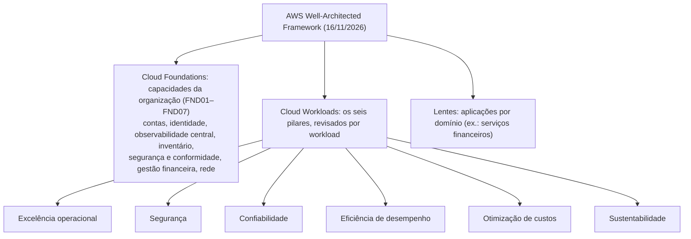

# S6.01 — Well-Architected Framework e seus pilares

> ⏱️ ~1h30 · 🟣 Sênior · Pré-requisitos: J10.03 (modelo de nuvem, responsabilidade compartilhada), J10.04 (conta, orçamento, IAM), P9.01/P9.02/P9.08 (rede, ECS/Fargate, RDS), S4.01 (SLO e orçamento de erro), S4.06 (Multi-AZ, opções A/B/C), S4.07 (capacidade), S5.01 (defesa em profundidade), S5.07 (revisão com régua e cobertura)

> ⚠️ **Verificação:** `lab/WellArchitectedLab.java` (Java puro, JDK 25.0.5.1) **foi executado**: (1) **preço** das opções de folga da S4.06 e do Multi-AZ do RDS com **preços reais da AWS Price List** (arquivos públicos, publicados entre **08 e 23/11/2026**, gravados em `lab/prices.csv` por `lab/fetch-prices.py`); (2) um ***linter* de revisão Well-Architected** (cobertura de pilares, risco com dono/prazo/ação, evidência) contra a revisão do PayFlow e contra uma revisão **ruim de propósito**. A **estrutura do framework** (Cloud Foundations + 6 pilares, níveis de risco, seções de *trade-off*) foi **conferida na documentação**, atualizada em **16/11/2026**. **A demanda por hora e as premissas de negócio são INVENTADAS** (declaradas no código). **NÃO executado:** o **AWS Well-Architected Tool** (exige conta), qualquer recurso na AWS, o PayFlow do aluno.

## 🎯 Objetivos
Ao final desta aula você consegue:
- **Nomear** os seis pilares do AWS Well-Architected e a camada **Cloud Foundations** (nova em 16/11/2026), e dizer **o que cada um pergunta**.
- **Conduzir** uma revisão como **conversa em marcos**, produzindo **riscos HIGH/MEDIUM com dono, prazo e ação**, e não uma nota.
- **Quantificar** um *trade-off* entre pilares com **preço datado**, **métrica de sucesso** e **data de revisão**.
- **Comparar** os frameworks da AWS, do Azure e do Google Cloud sem confundir os nomes dos pilares.
- **Escrever** a primeira revisão Well-Architected do PayFlow e **provar** que o *linter* dela reprova uma revisão ruim.

## 🤔 Por que isso importa
Até aqui o PayFlow acumulou **244 decisões**. Cada uma melhorou **um** aspecto: a S4 comprou **confiabilidade** (Multi-AZ, folga de AZ), a S5 comprou **segurança** (KMS, trilha, contas separadas), a P9 comprou **segurança de rede** (zero NAT, *endpoints*). **Nenhuma** foi apresentada com o **preço**. Num time, quem decide o orçamento pergunta: *"quanto custa ficar de pé quando uma AZ cai?"* e *"o que deixamos de fazer se pagarmos isso?"*. O sênior responde com **número, premissa e data**, não com "é boa prática".

O Well-Architected é o **vocabulário comum** para essa conversa: as mesmas perguntas para todo *workload*, os mesmos níveis de risco, o mesmo formato de *trade-off*. Ele **não** decide por você; ele **impede** que uma dimensão (custo, operação, sustentabilidade) seja esquecida.

## 💡 Intuição (explicação simples)
Pense no **check-up anual** de um médico. Ele não "aprova" você: faz **as mesmas perguntas** a todos os pacientes (pressão, sono, exercício, histórico), anota **o que é grave** (marcar cirurgia em 30 dias) e **o que é importante** (mudar a dieta), e **cada achado tem um próximo passo e uma data**. Ninguém sai com "nota 8"; sai com **uma lista curta de riscos priorizados**. E o médico sabe que **tudo tem custo**: o remédio mais forte tem efeito colateral. Revisão Well-Architected é isso para um sistema.

## 🔬 Como funciona por dentro

### 1. A estrutura atual (mudou há uma semana)
Em **16/11/2026** a AWS **consolidou os seis *whitepapers* de pilar num único documento**, **reescreveu quase todas as boas práticas** num formato padrão e **criou duas camadas** (notas de versão do framework):



- **Cloud Foundations** reúne o que antes estava espalhado pelos pilares e que **é da organização**, não de um *workload*: **conta e OUs** (FND01), **identidade e *guardrails*** (FND02), **observabilidade central** (FND03), **tags e inventário** (FND04), **segurança e conformidade** (FND05), **gestão financeira** (FND06: custo detalhado, atribuição padronizada, orçamentos, **compromissos**) e **rede** (FND07). A documentação diz que ela é **"o *blueprint* de uma *landing zone*"**: a S6.05 a usa.
- **Cloud Workloads** são **os seis pilares**, cada um com **princípios de design**, perguntas (`OPS01`, `SEC03`, `REL10`, `COST07`…) e, novidade, uma seção **"Understanding trade-offs"**.

| Pilar | Definição (resumo da documentação) | O que o PayFlow já tem (decisões) |
|---|---|---|
| **Excelência operacional** | rodar e observar o *workload*, melhorar processos continuamente | P6 (logs, métricas, traços), S4.02 *runbooks* (220), postmortem (221) |
| **Segurança** | proteger dados, sistemas e ativos | P10 (OAuth2), S5 inteira (229–244) |
| **Confiabilidade** | executar a função **correta e consistentemente** quando esperado, em todo o ciclo de vida | SLO (217), Multi-AZ (171, 224), *backup* (223), DR (225) |
| **Eficiência de desempenho** | usar recursos de forma eficiente e **manter** essa eficiência quando a demanda muda | S2 (medir antes), capacidade (226) |
| **Otimização de custos** | entregar valor de negócio **ao menor preço** | **quase nada** (só o alerta de US$ 10 da J10.04): **é a S6** |
| **Sustentabilidade** | reduzir energia e maximizar o uso do que foi provisionado | ARM64/Graviton (165), retenção de logs (170) |

> 🔎 **Links antigos ainda abrem.** As páginas por pilar (`.../reliability-pillar/welcome.html`, citadas na S4 e na S5) ainda respondem **200**, mas a página `the-pillars-of-the-framework.html` **dá 404**: a fonte de verdade agora é o documento único (link abaixo).

### 2. Níveis de risco: HRI e MRI
A documentação define **três níveis** para as boas práticas: **alto** (prática **fundamental**, "obrigatória": não seguir gera um **HRI**, *high risk issue*; exemplo dado: **não proteger a conta**), **médio** (prática que **habilita** e melhora muito: gera um **MRI**; exemplo: **não auditar nem girar credenciais**) e **baixo** (opcional; **não existe** "LRI", conta como **progresso**). E define o **nível de esforço** (baixo: horas a dias; médio: dias a semanas; alto: semanas a meses).

Isto é o que um revisor entrega: **não** uma nota, mas **HRIs e MRIs** priorizados, cada um com **dono, prazo e ação**, exatamente como a régua da S5.07 (severidade × SLA).

### 3. *Trade-offs* com número
As novas seções "Understanding trade-offs" (custo e confiabilidade lidas na íntegra) pedem a mesma coisa: **parta do requisito de negócio**, registre **as opções consideradas**, **uma estimativa quantitativa**, **métricas de sucesso** e **uma data de revisão**. O exemplo da própria documentação: *"implementamos Multi-AZ em todos os bancos de produção; isso aumenta o custo mensal do RDS em US$ 2.500, mas reduz o risco de indisponibilidade longa"*. E alertam: **custo não é "o mais barato"**, e **confiabilidade não é "redundância em tudo"**: invista **onde a falha mais dói** e **reserve** as opções caras (ativo/ativo multirregião, cinco noves) para os componentes cujo impacto **justifica**.

### 4. O processo de revisão
1. **Escopo:** um *workload* (o PayFlow: API, banco, mensageria, contas); as **fundações** são revistas **à parte** (outro dono, outra cadência).
2. **Marcos:** desenho, antes de ir para produção, depois de mudança grande, **e** periodicamente (a doc de custo sugere **revisões trimestrais** dos *trade-offs* principais).
3. **Conversa, não auditoria** (a documentação insiste): quem constrói responde; o revisor pergunta "como você sabe?" (**evidência**).
4. **Saída:** lista de HRIs/MRIs com dono, prazo e ação; **decisões de não fazer** registradas com gatilho (o padrão da S1–S5).
5. **Ferramenta:** o **AWS Well-Architected Tool** registra a revisão e importa **lentes personalizadas** (as duas novas, *Cloud Foundations* e *Cloud Workloads*, estão num repositório público). **Aqui** a revisão é um **CSV versionado** + ***linter***: funciona sem conta e entra no CI.

### 5. AWS, Azure e Google Cloud
| | AWS | Azure | Google Cloud |
|---|---|---|---|
| Nome | AWS Well-Architected Framework | Azure Well-Architected Framework | Google Cloud Well-Architected Framework |
| Pilares | **6**: excelência operacional, segurança, confiabilidade, eficiência de desempenho, otimização de custos, sustentabilidade | **5** na matriz da página: confiabilidade, segurança, otimização de custos, excelência operacional, eficiência de desempenho | **6**: excelência operacional; **segurança, privacidade e conformidade**; confiabilidade; otimização de custos; **otimização de desempenho**; sustentabilidade |
| Camada da organização | **Cloud Foundations** (FND01–07) | *Cloud Adoption Framework* / *landing zones* (S6.05) | *landing zones* (S6.05) |
| Visões transversais | **lentes** (ex.: *Financial Services Industry Lens*) | arquiteturas de referência e o **Azure Advisor** baseado nos pilares | **perspectivas** (IA/ML e **serviços financeiros**) |
| Revisão | Well-Architected Tool | Azure Well-Architected Review | (a página lista recursos e *skills* de agentes por pilar) |

**Leia o nome exato:** "eficiência de desempenho" (AWS/Azure) × "otimização de desempenho" (Google); o Google junta **privacidade e conformidade** ao pilar de segurança. Numa entrevista, citar "os cinco pilares da AWS" (o número antigo, antes da sustentabilidade de 2021) **denuncia** material desatualizado.

## 🛠️ Exemplo prático

### 1. Quanto custa a folga de AZ da S4.06 (preços reais)
A S4.06 deixou três opções **sem preço**. O laboratório usa a **mesma demanda por hora** (premissa: 0,20 a 1,50 vCPU ao longo do dia), tarefas de **0,5 vCPU / 1 GB ARM** (decisão 165), escala por hora e **calcula** quanto a AZ sobrevivente aguenta **no pior horário**:

```bash
cd lab
export JAVA_HOME=/usr/lib/jvm/java-25-openjdk-amd64
python3 -I fetch-prices.py --cache ~/.cache/s6-pricing   # opcional: refaz prices.csv (baixa ~1 GB em fluxo; minutos)
$JAVA_HOME/bin/java WellArchitectedLab.java tradeoff
```

```text
option                       task-h/day peak tasks        us-east-1/month        sa-east-1/month   worst CPU*
A: 2 AZs, min 2, target 60%          77          5              US$ 46.26              US$ 79.56         180%
B: 2 AZs, min 4, target 45%         114          7       US$ 68.48 (+48%)      US$ 117.79 (+48%)         110%
C: 3 AZs, min 3, target 60%          87          5      US$ 96.06 (+108%)     US$ 181.87 (+129%)         120%
B2: B, only multiples of 2          124          8       US$ 74.49 (+61%)      US$ 128.12 (+61%)          90%
   * worst CPU = highest utilization of the surviving tasks, in any hour, right after losing one AZ
```

**Como ler (o que a medição mostrou e a S4.06 não):**
1. A **opção B** custa **+48%** de computação e **não** entrega os 90% que a S4.06 calculou: deu **110%**. O motivo é **aritmético**: com *autoscaling*, o número de tarefas **varia de hora em hora** e às vezes é **ímpar** (5, 7); a AZ que cai leva `⌈n/2⌉` tarefas (3 de 5), e as 2 restantes ficam a **110%**. A S4.06 supôs divisão **igual**.
2. **B2** (só **números pares** de tarefas) devolve os **90%** por **+61%**. É **hipótese**: o *target tracking* do ECS **não** mantém contagens pares; seria preciso *step scaling* de 2 em 2 ou outra técnica (**a conferir e medir no E6** da S4.04).
3. **C (3 AZs)** custa **o dobro** não pela computação, mas pelos **seis *endpoints* de interface na 3ª AZ** (US$ 0,021/h cada em `sa-east-1`): **com pouco tráfego, o custo fixo por AZ domina**. E com 5 tarefas em 3 AZs o pior caso ainda passa de 100%.
4. **Números absolutos pequenos** (dezenas de dólares): a decisão **não** é "economizar US$ 22"; é **saber quanto custa cada ponto de folga** e **parar de supor divisão igual**.

### 2. O Multi-AZ do RDS: quanto vale uma hora parada?
```text
   us-east-1: Single-AZ US$ 134.14, Multi-AZ US$ 269.01, extra US$ 134.87/month = US$ 1,618.44/year
      breaks even if 1 hour of payments down costs more than US$ 822.94 (premise: 1 AZ event/year, RTO 2 h -> 2 min)
   sa-east-1: Single-AZ US$ 183.23, Multi-AZ US$ 366.46, extra US$ 183.23/month = US$ 2,198.76/year
      breaks even if 1 hour of payments down costs more than US$ 1,118.01 (premise: 1 AZ event/year, RTO 2 h -> 2 min)
```
O Multi-AZ **dobra** a linha do banco (instância **e** armazenamento: o gp3 Multi-AZ custa o dobro do Single-AZ na Price List). A pergunta de negócio vira **uma só**: *"uma hora sem pagamentos custa mais que ~US$ 1,1 mil?"*. Para uma carteira com milhões de transferências por mês, quase certamente **sim**: a **decisão 171** se mantém, **agora com o preço** e com a premissa (1 evento por ano; RTO de 2 h sem Multi-AZ, **a medir** no ensaio de restauração da S4.05). **Quem assina o "custo por hora parado" é o negócio** (a mesma regra da decisão 225).

### 3. A mesma arquitetura em duas regiões
```text
3. Same architecture, two regions: sa-east-1 / us-east-1 price ratio
   fargate.arm.vcpu_h           0.032380   0.055700  x1.72
   rds.pg.m7g.large.multi_h     0.337000   0.442000  x1.31
   rds.gp3.multi_gb_mo          0.230000   0.438000  x1.90
   vpc.endpoint_h               0.010000   0.021000  x2.10
   cw.logs_ingest_gb            0.500000   0.900000  x1.80
   kms.key_mo                   1.000000   1.000000  x1.00
```
`sa-east-1` (São Paulo) custa **de 1,0× a 2,1×** `us-east-1`, **item a item**: não existe "São Paulo é X% mais cara"; depende **do que a sua conta usa** (a S6.04 fecha a conta inteira: **×1,60**). A **escolha da região** é um *trade-off* de **três** eixos: **preço** (medido aqui), **latência** para o usuário (**a medir**: nenhum número de latência foi medido neste treinamento) e **requisitos regulatórios e contratuais** (**a confirmar** com o jurídico; **não** afirmamos aqui o que a regulação exige).

### 4. A revisão do PayFlow como CSV + *linter*
`samples/wa-review-payflow.csv` tem **20 perguntas** (uma linha cada: `id;pilar;pergunta;risco;evidência;dono;prazo;ação`). O *linter* exige: **todo pilar** com ao menos uma resposta; **HIGH/MEDIUM** com **dono** (`@alguem`), **prazo** depois da revisão (HIGH em **≤ 90 dias**, proposta) e **ação**; **"sem risco"** com **evidência** (decisão, ADR, `docs/`, `out-*.txt` ou aula); **"não se aplica"** com justificativa.

```bash
$JAVA_HOME/bin/java WellArchitectedLab.java review samples/wa-review-payflow.csv 2026-11-23
$JAVA_HOME/bin/java WellArchitectedLab.java review samples/wa-review-bad.csv 2026-11-23
```

```text
review wa-review-payflow.csv (20 items, date 2026-11-23)
pillar  HIGH  MEDIUM  NONE   NA
FND        3       1     0    0
OPS        1       0     1    0
SEC        0       1     2    0
REL        0       2     1    0
PERF       0       1     1    0
COST       0       2     1    1
SUS        0       0     2    0
RESULT: PASS
```

```text
  PROBLEM 2 FND01: risco HIGH sem dono (@alguem)
  PROBLEM 3 OPS01: 'sem risco' sem evidência (decisão, ADR, docs/, out-*.txt ou aula)
  PROBLEM 5 REL01: prazo 2026-11-01 não está depois da revisão
  PROBLEM 6 PERF01: risco HIGH com prazo > 90 dias (2027-06-30)
  PROBLEM 7 COST01: 'não se aplica' sem justificativa (NA: ...)
  PROBLEM pilar SUS sem nenhuma pergunta respondida
RESULT: FAIL (6 problems)
```

**O que a revisão do PayFlow diz (é o resultado, não a ferramenta):** os **quatro HIGH** estão **nas fundações e na operação**, não no código: **tudo numa conta** (FND01), **sem *guardrails* de organização** (FND02), **sem orçamento por ambiente** (FND06) e **nada ensaiado no PayFlow real** (OPS02: os testes práticos ficaram para o fim, por decisão do aluno). Segurança e confiabilidade têm só **MRIs**, porque a S4 e a S5 já trabalharam nelas. **COST03** está como **NA justificado**: comprar compromisso **sem 3 meses de uso real** é chute (S6.04).

## 🏗️ Estudo de caso: "B ou B2?" (formato ADR)
**Contexto.** A S4.06 recomendou **B** (mínimo 4 tarefas, alvo 45%) para aguentar a perda de uma AZ a **90%** de CPU. A medição desta aula mostrou que, com escala real, **B chega a 110%** em horas com contagem ímpar.

**Opções.** (1) **B** como está: +48% de computação, pior caso 110%. (2) **B2**, contagens pares: +61%, pior caso 90%, **exige** mudar a política de escala (*step scaling* de 2 em 2, a validar). (3) **C**, 3 AZs: +108% a +129%, pior caso 120% com 5 tarefas, e **mais um conjunto de *endpoints*** para manter. (4) **Alvo 40% sem paridade**: não simulado aqui (exercício 3).

<details><summary>Decisão (proposta) e por quê</summary>

**Manter B como base e testar B2 no ensaio E6** (perda de AZ, S4.04): a diferença B → B2 é de **~US$ 6–10/mês** nos preços de hoje, contra **20 pontos de CPU** no pior minuto do ano. **C fica descartada** enquanto o custo fixo por AZ (*endpoints*) dominar e enquanto 2 AZs atenderem ao SLO. **Métrica de sucesso:** no E6, **p99 ≤ 500 ms** (SLO da S4.01) durante a perda da AZ. **Revisão:** no próximo marco ou se o tráfego dobrar. **Registro:** decisão 246, ADR 0029. **Ressalva:** demanda **inventada**; refaça com a curva real do PayFlow (S2.06).
</details>

## ⚖️ Trade-offs e quando NÃO usar
- **Revisão como portão de *deploy***: a documentação diz que **não é auditoria**. Use os HRIs para **priorizar**, não para bloquear toda entrega (o bloqueio fica para regras objetivas: SCP, CI).
- **"Passar em todas as perguntas"** é **excesso de engenharia**: um *workload* de estudo não precisa de multirregião. Responda **NA com justificativa**.
- **Pilar isolado**: otimizar só custo derruba confiabilidade; só confiabilidade estoura o orçamento. O formato de *trade-off* (custo, métrica, data) existe **para** a conversa entre pilares.
- **Ferramenta × hábito**: o Well-Architected Tool ajuda a registrar; **sem dono e prazo** a revisão vira PDF esquecido. O CSV + *linter* no repositório é **mais pobre** que o Tool, mas **vive junto do código**.
- **Quando não fazer agora:** antes de existir **uso real** e **SLO aceito**, a revisão vira especulação; faça a de **desenho** (curta) e marque a de **produção** para depois do primeiro mês.

## ⚠️ Erros comuns e boas práticas de produção
- **Citar números de custo sem data e sem região.** Preço muda (a Price List do RDS que usamos foi publicada em 20/11/2026). Sempre `preço + região + data + premissas`.
- **Supor divisão igual entre AZs** (o erro da S4.06 que esta aula pegou): calcule com a contagem **real** de tarefas.
- **HRI sem dono** (o *linter* recusa: `risco HIGH sem dono (@alguem)`). Um risco sem dono **não** será tratado.
- **"Sem risco" porque "temos alguns *runbooks*"** (o `OPS01` da revisão ruim): evidência é **link verificável**.
- **Confundir pilares entre provedores** (Azure lista **5**; o Google chama de **"otimização de desempenho"**).
- **Revisar o *workload* e esquecer as fundações**: os 3 HIGH do PayFlow estão em **FND**. Desde 16/11/2026 a AWS separa as duas revisões justamente por isso.

## 🧩 Exercícios
1. **Fixação.** Classifique em pilar **e** em HRI/MRI: (a) não há alarme de 5xx; (b) o *staging* fica ligado 24×7; (c) a chave do *backup* está na mesma conta do banco; (d) imagens x86 onde ARM serviria; (e) não há teste de carga.
2. **Aplicação no PayFlow.** Crie `docs/cloud/well-architected-review.csv` a partir de `lab/samples/wa-review-payflow.csv`, **acrescente 3 perguntas** (uma de OPS, uma de PERF, uma de SUS) e rode o *linter*.
   - [ ] o *linter* passa (`RESULT: PASS`);
   - [ ] todo HIGH tem dono, prazo ≤ 90 dias e ação;
   - [ ] todo "sem risco" aponta uma decisão, ADR, `docs/` ou saída real;
   - [ ] a revisão está no CI (o *job* falha se o *linter* falhar);
   - [ ] o *trade-off* B × B2 está registrado com custo, métrica e data.
3. **Desafio (opcional).** Acrescente ao `WellArchitectedLab` a opção **"B com alvo 40%, sem paridade"** e compare com B2. Qual entrega ≤ 90% mais barato?

<details><summary>Soluções de referência</summary>

1. (a) **OPS** (e REL), **HIGH**: sem detecção não há resposta a incidente; (b) **COST/SUS**, **MEDIUM**; (c) **SEC/REL** e **FND01**, **HIGH** (causa comum, S5.01); (d) **COST/SUS**, **MEDIUM** (no Fargate o x86 custa **1,25×** o ARM por vCPU, isto é, o ARM sai **20% mais barato**: S6.02); (e) **PERF**, **MEDIUM**.
2. Exemplo de linha válida: `PERF03;PERF;Pool de conexões dimensionado pela conta de conexões?;NONE;decisão 181;;;`. O *job* de CI é uma linha: `java WellArchitectedLab.java review docs/cloud/well-architected-review.csv $(date +%F)`.
3. Mude `new Option("B: ...", 2, 4, 0.45, 0, false)` para `0.40` numa nova linha e rode. A comparação é sua: **compare custo × pior CPU**, e lembre que paridade **depende** da política de escala.
</details>

## 🎤 Na entrevista
1. **"Quais são os pilares do Well-Architected e como você os usa?"** *Resposta-modelo:* seis: excelência operacional, segurança, confiabilidade, eficiência de desempenho, otimização de custos e sustentabilidade; desde novembro de 2026 a AWS separa as **Cloud Foundations** (contas, identidade, custo da organização). Uso como **roteiro de revisão em marcos**: saio com HRIs e MRIs com dono e prazo, e com os *trade-offs* entre pilares **quantificados** (custo mensal, métrica, data de revisão).
2. **"Dê um exemplo de *trade-off* entre pilares que você quantificou."** *Resposta-modelo:* Multi-AZ do banco: **dobra** a linha do RDS (+US$ 183/mês em São Paulo para um `db.m7g.large`); paga a si mesmo se uma hora de pagamentos parados custar mais que ~US$ 1,1 mil, com a premissa de um evento por ano. Quem assina o custo da hora parada é o negócio.
3. **"Como você evita que a revisão vire burocracia?"** *Resposta-modelo:* escopo de um *workload*, perguntas que se aplicam, **NA justificado**, lista curta de riscos com dono, e **mecanismos** (SCP, CI, alertas) para o que pode ser automatizado; a revisão é conversa, não auditoria.

## 📚 Para ir além
- 📄 **AWS Well-Architected Framework** (documento único): https://docs.aws.amazon.com/wellarchitected/latest/framework/welcome.html (atualizado em 16/11/2026).
- 📄 **Notas de versão** (o que mudou em 16/11/2026): https://docs.aws.amazon.com/wellarchitected/latest/framework/release-notes.html
- 📄 **Definições** (pilares, HRI/MRI, nível de esforço): https://docs.aws.amazon.com/wellarchitected/latest/framework/definitions.html
- 📄 **Cloud Foundations** (FND01–FND07): https://docs.aws.amazon.com/wellarchitected/latest/framework/cloud-foundations.html
- 📄 ***Trade-offs* de custo** e **de confiabilidade** (o formato com custo, métrica e data): https://docs.aws.amazon.com/wellarchitected/latest/framework/cost-understanding-tradeoffs.html e https://docs.aws.amazon.com/wellarchitected/latest/framework/rel-understanding-tradeoffs.html
- 📄 **Princípios de design de custo**: https://docs.aws.amazon.com/wellarchitected/latest/framework/cost-design-principles.html
- 📄 **AWS Well-Architected Tool** (lentes, revisões): https://docs.aws.amazon.com/wellarchitected/latest/userguide/intro.html
- 📄 **Lente de serviços financeiros** (o domínio do PayFlow): https://docs.aws.amazon.com/wellarchitected/latest/financial-services-industry-lens/financial-services-industry-lens.html
- 📄 **Azure Well-Architected Framework, pilares**: https://learn.microsoft.com/en-us/azure/well-architected/pillars
- 📄 **Google Cloud Well-Architected Framework**: https://cloud.google.com/architecture/framework
- 📄 **AWS Price List Bulk API** (de onde vêm os preços do laboratório): https://docs.aws.amazon.com/awsaccountbilling/latest/aboutv2/using-the-aws-price-list-bulk-api.html
- 📑 *Fundamentals of Software Architecture* (Richards e Ford), capítulos sobre **características de arquitetura** e ***trade-offs*** ("tudo em arquitetura é um *trade-off*").

## ✅ Checklist da aula
- [ ] Rodei `WellArchitectedLab tradeoff` e expliquei por que **B deu 110%** e não 90%.
- [ ] Sei os **seis pilares**, as **Cloud Foundations** e a diferença entre **HRI** e **MRI**.
- [ ] Quantifiquei um *trade-off* com **preço datado, métrica e data de revisão**.
- [ ] Rodei o *linter* na revisão boa (**PASS**) e na ruim (**FAIL, 6 problemas**).
- [ ] Escrevi (ou adaptei) a revisão do PayFlow com os **4 HIGH** e seus donos.
- [ ] Anotei o que **não** foi executado (Well-Architected Tool, AWS real, PayFlow).
