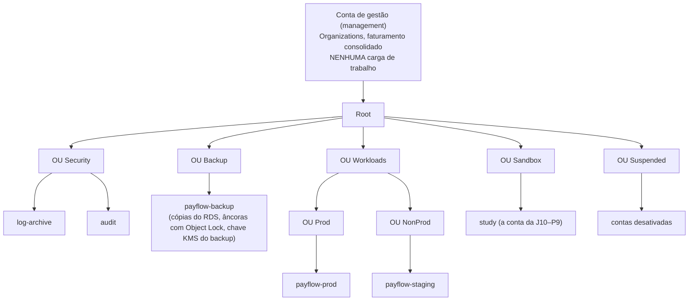

# S6.05 — Landing zones e contas por ambiente

> ⏱️ ~1h30 · 🟣 Sênior · Pré-requisitos: S6.01 (Cloud Foundations, FND01), S6.04 (tags, orçamentos por conta), J10.04 (usuário *root*, MFA, IAM), P8.07 (Terraform), P10.05 (menor privilégio), S4.05 (*backup* em outra conta), S5.01 (causa comum, *break-glass*), S5.03 (chave do *backup*, decisão 237), S5.06 (CloudTrail e trilha)

> ⚠️ **Verificação:** `lab/LandingZoneLab.java` (Java puro, JDK 25.0.5.1) **foi executado**: um **modelo** da avaliação de SCPs **documentada** (Allow em **todos** os níveis da raiz até a conta; negação explícita vence; SCP **não concede**; conta de gestão e papéis vinculados a serviço **não** são afetados), lendo **os mesmos JSON** de `lab/samples/scp/` que a entrega aplica, com **17 casos** e **5 mutantes/variantes**, e as **regras estruturais** das cotas do Organizations (≥ 1 e ≤ 10 SCPs por entidade). O módulo `lab/terraform/organization` (OUs, políticas, anexos) passou no **`terraform validate`**. **É um modelo, não a AWS:** subconjunto de ações e condições, **sem** RCP, políticas de recurso e limites de permissão. **A leitura das cotas achou um erro no meu primeiro desenho** (OU sem nenhuma SCP: recusada). **NÃO executado:** AWS Organizations, Control Tower, IAM Identity Center, criação de contas, o PayFlow do aluno.

## 🎯 Objetivos
Ao final desta aula você consegue:
- **Explicar** por que a **conta** é a fronteira de isolamento mais forte (credenciais, cotas, custo, raio de explosão) e o que é uma ***landing zone***.
- **Desenhar** as OUs e contas do PayFlow a partir da estrutura **recomendada** pela AWS.
- **Escrever *guardrails*** (SCPs) para região, auditoria, *backup*, tags e *sandbox*, e **testá-los** com casos e mutantes.
- **Dizer o que uma SCP não faz** (conceder, valer na conta de gestão, valer para papéis vinculados a serviço) e **onde a conta de gestão precisa de outra proteção**.
- **Planejar** a saída da conta única do PayFlow sem parar o estudo.

## 🤔 Por que isso importa
O PayFlow mora **numa conta** desde a J10. A S4.05 pediu o *backup* **em outra conta**; a S5.01 contou a **causa comum** "banco e *backup* na mesma conta"; a S5.03 pôs a chave do *backup* "na conta de *backup*"; a revisão da S6.01 deu **3 HIGH** nas fundações. **Todas** apontam para o mesmo lugar: **contas separadas, com regras que nem o administrador da conta consegue quebrar**. Isso é *landing zone*, e é trabalho de **sênior/plataforma**: errar aqui é deixar uma credencial de administrador apagar **produção e *backups*** no mesmo minuto.

## 💡 Intuição (explicação simples)
Um **condomínio**. Cada **apartamento** é uma conta: o morador (administrador da conta) faz o que quiser **dentro** dele. Mas o **regulamento do condomínio** (SCP) vale para **todos os moradores**, inclusive o dono do apartamento: ninguém derruba parede de sustentação, ninguém desliga a câmera da portaria. O regulamento **não dá** a chave de nenhum apartamento (SCP **não concede** permissão); ele só **proíbe**. E o **síndico** (conta de gestão) **não está sujeito** ao regulamento que ele mesmo aplica: por isso o síndico **não mora** no prédio (nenhuma carga de trabalho na conta de gestão) e quase ninguém tem a chave dele.

## 🔬 Como funciona por dentro

### 1. Por que contas, e não só papéis do IAM
O *whitepaper* de organização de ambientes da AWS define a conta como **fronteira de isolamento** de identidade e acesso. Na prática, separar contas separa: **credenciais** (um papel comprometido em `staging` não alcança `prod`), **cotas de serviço**, **fatura** (o custo por conta é a atribuição **mais simples**, S6.04) e **raio de explosão** de um erro (o `terraform destroy` no diretório errado). O Well-Architected põe isso em **FND01** (estrutura de conta de gestão e OUs, donos de cobrança/segurança/operação, fronteiras por ambiente, estratégia para ambientes **experimentais e temporários**) e diz que as Cloud Foundations são **"o *blueprint* de uma *landing zone*"**: um ambiente multicontas bem arquitetado, com segurança e conformidade desde o início.

### 2. A estrutura recomendada (e a do PayFlow)
O *whitepaper* recomenda OUs **fundamentais** (**Security**: contas que aplicam segurança e conformidade; **Infrastructure**: rede e serviços compartilhados), de **aplicação** (**Workloads**, com produção e não produção), **experimentais** (**Sandbox**) e outras (**Policy Staging** para testar políticas antes de aplicar, **Suspended**, **Exceptions**, **Deployments**, **Transitional**, **Individual Business Users**). E avisa: a **OU de segurança** deve conter **só** as contas essenciais do Control Tower (*log archive* e auditoria); contas de segurança **adicionais** ficam **em outra OU**.


**Por que `payflow-backup` numa OU própria:** a decisão 237 e a S4.05 pedem a cópia e a chave **fora** do alcance de quem administra produção; o *whitepaper* manda contas de segurança extras para **fora** da OU Security. **São 7 contas** com a de gestão (mais as que forem suspensas); a cota **padrão** do Organizations é **10 contas** (ajustável), e as OUs aninham até **5 níveis**.

### 3. Como uma SCP decide (o que o laboratório modela)
- SCPs definem as **permissões máximas** de usuários e papéis das contas-membro; **nunca concedem** nada (quem concede é a política do IAM).
- Para uma ação ser **permitida**, precisa haver **Allow em todos os níveis**, da raiz, passando por cada OU, até a conta. Por isso o Organizations anexa a **`FullAWSAccess`** (Allow de tudo) em toda raiz, OU e conta criada; tirar essa política de uma OU **bloqueia tudo** abaixo dela.
- Um **Deny** em **qualquer** nível vence. No IAM, a regra geral: **uma negação explícita** numa política de identidade, numa SCP ou numa RCP **anula** qualquer Allow.
- **Não são afetados:** usuários e papéis da **conta de gestão** e **papéis vinculados a serviço** (*service-linked roles*). **São afetados**: todos os usuários e papéis das contas-membro, **inclusive o usuário *root***.
- **Cotas:** toda entidade precisa de **pelo menos uma** SCP (não dá para tirar a última); no máximo **10** por raiz, OU ou conta; cada documento com até **10.240 caracteres**.
- **RCP (*resource control policy*)**: o equivalente **do lado do recurso** (permissões máximas sobre recursos de um subconjunto de serviços), também **sem** conceder. Fica fora do laboratório.
- **Chave de condição ausente:** operador positivo (`StringEquals`) dá **falso**; operador negado (`StringNotLike`, `ArnNotLike`) dá **verdadeiro** (documentação do IAM). É isso que faz o `Null` de tag e a exceção do *break-glass* funcionarem.

### 4. Os *guardrails* do PayFlow
| SCP | Onde | O que impede | Lição |
|---|---|---|---|
| `deny-leave-org` | Root | a conta sair da organização (e das regras) | barata e sempre útil |
| `deny-root-user` | Root | o *root* das contas-membro de agir | o *root* **é** afetado por SCP |
| `deny-outside-regions` | Root | qualquer serviço fora de `us-east-1`/`sa-east-1`, **exceto** CloudFront, IAM, Route 53 e Support (`NotAction`) | serviços **globais** têm o *endpoint* em `us-east-1` (exemplo da documentação do IAM) |
| `protect-audit` | Root | parar/apagar/alterar a trilha do CloudTrail e o gravador do Config | a trilha da S5.06 sobrevive a um admin comprometido |
| `protect-backup` | conta `payflow-backup` | agendar exclusão/desabilitar chave KMS, apagar cofre/ponto de recuperação, mexer no *Object Lock*, exceto o papel `payflow-breakglass` | fecha a decisão 237 com uma regra que **nem o admin** quebra |
| `require-cost-tags` | OU Workloads | `ec2:RunInstances`/`rds:CreateDBInstance` **sem** `cost-center` | a *tag policy* **não** avalia recurso sem tag (S6.04) |
| `sandbox-limits` | OU Sandbox | instâncias e bancos fora de `t4g.*`/`db.t4g.*` | *guardrail* de **custo** para estudo |
| `deny-all` | OU Suspended | tudo | a OU precisa de **alguma** SCP (cota) |

```json
{
  "Version": "2012-10-17",
  "Statement": [
    {
      "Sid": "DenyOutsideApprovedRegions",
      "Effect": "Deny",
      "NotAction": ["cloudfront:*", "iam:*", "route53:*", "support:*"],
      "Resource": "*",
      "Condition": { "StringNotEquals": { "aws:RequestedRegion": ["us-east-1", "sa-east-1"] } }
    }
  ]
}
```
**Por que as duas regiões:** a escolha da região primária **ainda está aberta** (S6.01: preço medido; latência e exigências **a confirmar**). A SCP **não** decide isso; ela **limita** o estrago a duas regiões conhecidas.

### 5. Control Tower, Terraform e identidade
O **AWS Control Tower** orquestra Organizations, Service Catalog e IAM Identity Center para montar uma *landing zone* (contas de *log archive* e auditoria, **controles**, também chamados *guardrails*). A alternativa é **Terraform** direto no Organizations (o módulo desta aula). Humanos entram pelo **IAM Identity Center** (o antigo AWS SSO, renomeado em 2022): um *login*, **conjuntos de permissões** por conta, **sem** usuários IAM com chave longa (a J10.04 usou um usuário IAM com MFA para estudo; em produção, **não**).

## 🛠️ Exemplo prático

### 1. Os 17 casos
```bash
cd lab && export JAVA_HOME=/usr/lib/jvm/java-25-openjdk-amd64
$JAVA_HOME/bin/java LandingZoneLab.java
```

```text
Structure: every root, OU and account has 1 to 10 SCPs
 1 ok   ALLOW dev updates the ECS service in prod                allowed by identity, inside every SCP
 2 ok   DENY  dev launches an instance in eu-west-1              explicit deny in SCP deny-outside-regions @Root
 3 ok   ALLOW admin creates an IAM role (global, us-east-1)      allowed by identity, inside every SCP
 4 ok   DENY  admin stops CloudTrail in prod                     explicit deny in SCP protect-audit @Root
 5 ok   ALLOW admin stops CloudTrail in the MANAGEMENT account   management account: SCPs do not apply
 6 ok   DENY  admin schedules deletion of the backup key         explicit deny in SCP protect-backup @payflow-backup
 7 ok   ALLOW break-glass schedules deletion of the backup key   allowed by identity, inside every SCP
 8 ok   DENY  dev launches in staging without cost-center        explicit deny in SCP require-cost-tags @Workloads
 9 ok   ALLOW dev launches in staging with cost-center           allowed by identity, inside every SCP
10 ok   DENY  dev launches m7i.24xlarge in the sandbox           explicit deny in SCP sandbox-limits @Sandbox
11 ok   ALLOW dev launches t4g.small in the sandbox              allowed by identity, inside every SCP
12 ok   ALLOW service-linked role acts in eu-west-1              service-linked role: SCPs do not apply
13 ok   DENY  dev deletes a bucket (SCP allows, identity does not) identity policy does not allow (SCPs never grant)
14 ok   DENY  root user of a member account reads S3             explicit deny in SCP deny-root-user @Root
15 ok   DENY  admin tries to leave the organization              explicit deny in SCP deny-leave-org @Root
16 ok   DENY  admin in a suspended account reads S3              explicit deny in SCP deny-all @Suspended
17 ok   DENY  admin deletes the trail in log-archive             explicit deny in SCP protect-audit @Root
RESULT: 17/17 cases as expected
```

**Os casos que ensinam:**
- **5:** a **mesma** ação negada em produção (caso 4) é **permitida** na conta de gestão. A conta de gestão se protege **de outro jeito**: MFA, pouquíssimas pessoas, **nenhuma carga de trabalho**, alertas sobre o uso dela.
- **7:** o *break-glass* consegue: emergência **existe** (S5.01), mas o uso dele dispara o alerta `PayflowBreakGlassUsed` (S5.06).
- **12:** um papel vinculado a serviço age até **fora** das regiões aprovadas: SCP não é a única cerca.
- **13:** a SCP permite, a política de identidade **não**: **negado**. SCP só **tira**.

### 2. Mutantes: um *guardrail* que nunca falha não prova nada
```text
  V0 variant: only sa-east-1, global-service exception kept                   -> cases [1, 7, 11] changed
  M1 only sa-east-1 and NO global-service exception (NotAction -> Action *)   -> cases [1, 3, 7, 11] changed
  M2 protect-backup without the break-glass exception                         -> cases [7] changed
  M3 FullAWSAccess detached from the Workloads OU                             -> cases [1, 3, 9] changed
  M4 protect-audit attached to Workloads instead of Root                      -> cases [17] changed
  M5 Suspended OU with no SCP at all (my first design)                        -> REJECTED: Suspended has no SCP attached (Organizations requires at least one)
```
- **V0 × M1** é a armadilha clássica: se a empresa decidir **só São Paulo** e escrever a SCP com `Action: "*"`, o **caso 3** (criar papel no IAM, cujo *endpoint* é `us-east-1`) **quebra em todas as contas**. Com o `NotAction` da documentação, só as ações **regionais** fora de São Paulo caem.
- **M2:** sem a exceção, **ninguém** gira ou recupera a chave do *backup* numa emergência.
- **M3:** tirar a `FullAWSAccess` de uma OU nega **tudo** abaixo (inclusive o IAM do caso 3): o motivo da OU **Policy Staging**.
- **M4:** proteger a trilha só em Workloads deixa a **conta de *log archive*** desprotegida (caso 17).
- **M5 (o erro que a leitura achou):** meu primeiro desenho deixava a OU Suspended **sem nenhuma SCP** para "negar tudo implicitamente". As cotas do Organizations dizem que **toda entidade precisa de pelo menos uma SCP**: a AWS **recusaria**. A correção é a SCP `deny-all` explícita (e, **só depois** de anexá-la, tirar a `FullAWSAccess`).

### 3. O módulo de Terraform (validado)
`lab/terraform/organization/main.tf` cria as OUs, as políticas a partir dos **mesmos JSON** e os anexos (um `for_each` sobre o mapa política → alvos), e passou no `terraform validate` (Terraform 1.17.1, provedor 6.73.0). Ele roda **na conta de gestão**. **💸** Organizations e SCPs **não** têm cobrança própria; **as contas criadas** têm (cada uma com seus recursos). **Teste primeiro numa OU de *Policy Staging*** com uma conta descartável e **só então** anexe na raiz. **Desfazer:** `terraform destroy` desanexa e apaga políticas e OUs (contas **não** são apagadas por ele).

## 🏗️ Estudo de caso: "Uma credencial de administrador vazou"
**Contexto (sintético).** Um *token* de administrador de `payflow-prod` vaza num *log* de CI. O atacante tenta: apagar o banco, apagar os *snapshots*, agendar a exclusão da chave KMS do *backup*, parar o CloudTrail e criar instâncias de mineração em `ap-southeast-1`.

**Com a conta única de hoje:** banco, *snapshots*, chave e trilha estão **ao alcance da mesma credencial** (a causa comum da S5.01). O que sobra depende de *backup* fora da AWS (que o PayFlow não tem) e de o CloudTrail ter sido lido antes de ser parado.

**Com a *landing zone*:**

<details><summary>O que cada camada segura (e o que não segura)</summary>

| Tentativa | Resultado | Quem segurou |
|---|---|---|
| apagar o RDS de produção | **consegue** (é admin de prod) | ninguém: por isso existe *backup* |
| apagar cópias de *snapshot* | **não alcança**: estão em `payflow-backup` | **a conta** (fronteira) |
| agendar exclusão da chave do *backup* | **negado** (caso 6) | SCP `protect-backup` |
| parar o CloudTrail | **negado** (caso 4) | SCP `protect-audit` na raiz |
| minerar em `ap-southeast-1` | **negado** (caso 2) | SCP `deny-outside-regions` |
| minerar em `us-east-1` com tag | **consegue** | orçamento + anomalia **por serviço** (S6.04) **detectam**; não impedem |

**Recuperação:** restaurar a partir da conta de *backup* (RPO da decisão 223), **reaplicar a conciliação** (S4.05) e girar a credencial. **Risco residual:** a **conta de gestão** (SCP não vale lá) e o **papel *break-glass*** (casos 5 e 7): por isso MFA, poucas pessoas e alerta de uso. Decisões 256 e 257, ADR 0029.
</details>

## ⚖️ Trade-offs e quando NÃO usar
- **Contas demais, cedo demais:** cada conta tem rede, *endpoints*, alarmes e custo fixo próprios (a S6.04 mostrou que *endpoints* por hora já são 21% da conta). Para um time pequeno, **6–8 contas** bastam; contas por microsserviço só com equipe de plataforma.
- **SCP como única defesa:** não vale na conta de gestão nem em papéis vinculados a serviço, e **não** substitui o menor privilégio (P10.05): é **teto**, não **regra fina**.
- **Lista de negação gigante** ("negar 200 ações perigosas"): difícil de testar e de manter; prefira poucas regras **testadas com casos e mutantes**.
- **Control Tower × Terraform:** o Control Tower entrega contas de *log*/auditoria e controles prontos, mas gerencia SCPs e recursos próprios (cuidado ao misturar com Terraform nas mesmas políticas). O Terraform deixa tudo no Git, porém **você** monta o que o Control Tower daria pronto.
- **Bloquear região sem a exceção de serviços globais** (mutante M1): quebra o IAM em todas as contas.

## ⚠️ Erros comuns e boas práticas de produção
- **Rodar carga de trabalho na conta de gestão:** SCP não a protege. Ela só administra a organização e a fatura.
- **Tirar a `FullAWSAccess` antes de anexar a política nova:** a entidade fica **sem SCP** (a AWS recusa) ou **sem Allow** (tudo negado).
- **Aplicar SCP direto na raiz** sem passar pela OU de teste (*Policy Staging*).
- **Esquecer que o *root* das contas-membro existe:** proteja com MFA e com a SCP `deny-root-user`.
- **Usuários IAM com chave de acesso para humanos:** use IAM Identity Center.
- **Orçamento só na conta pagadora:** crie orçamento **por conta** (o módulo da S6.04 por ambiente).
- **Achar que *tag policy* exige tag:** ela **padroniza**; quem **exige na criação** é a SCP com `Null`.

## 🧩 Exercícios
1. **Fixação.** Para cada afirmação, verdadeiro ou falso (com o caso do laboratório que prova): (a) uma SCP pode conceder `s3:GetObject`; (b) o *root* de uma conta-membro é afetado por SCP; (c) a conta de gestão é afetada por SCP; (d) dá para deixar uma OU sem nenhuma SCP; (e) um papel vinculado a serviço respeita a SCP de regiões.
2. **Aplicação no PayFlow.** Escreva `docs/cloud/landing-zone.md` e `infra/terraform/organization/` (copie de `lab/`), com o plano de migração da conta única.
   - [ ] diagrama de contas e OUs com **dono** de cada conta;
   - [ ] as 8 SCPs versionadas em JSON e **os 17 casos + 5 mutantes** rodando no CI (`LandingZoneLab`);
   - [ ] plano de migração: **nova conta de gestão**; a conta atual vira `study` (Sandbox); `log-archive`/`audit` e `payflow-backup` **primeiro**; `payflow-prod` criada **do zero** pelo Terraform da P8/P9;
   - [ ] humanos pelo IAM Identity Center; o papel `payflow-breakglass` com MFA e alerta de uso;
   - [ ] orçamento e monitor de anomalia **por conta** (S6.04).
3. **Desafio (opcional).** Acrescente ao laboratório um caso e uma SCP que **proíbam desligar o *Object Lock*** de um *bucket* de âncoras também em `log-archive`, e um mutante que a mate.

<details><summary>Soluções de referência</summary>

1. (a) **F** (caso 13: SCP nunca concede); (b) **V** (caso 14); (c) **F** (caso 5); (d) **F** (M5: a cota exige ≥ 1 SCP); (e) **F** (caso 12).
2. Ordem sugerida e por quê: as contas de *log* e *backup* primeiro porque **protegem** as demais desde o primeiro dia; produção do zero porque nada do PayFlow está em produção ainda (OPS02 da S6.01) e recriar pelo Terraform **testa** o próprio Terraform.
3. Acrescente `s3:PutBucketObjectLockConfiguration` a uma SCP anexada à OU Security (ou à raiz), um caso `log-archive / admin / s3:PutBucketObjectLockConfiguration → DENY` e um mutante que remove a ação da lista (o caso deve mudar).
</details>

### Equivalência AWS ↔ Azure ↔ Google Cloud
| Conceito | AWS | Azure | Google Cloud |
|---|---|---|---|
| Hierarquia | Organizations: raiz → OUs → **contas** | *management groups* → **assinaturas** → grupos de recursos | organização → pastas (*folders*) → **projetos** |
| *Guardrails* | SCPs e RCPs | Azure Policy | Organization Policy Service |
| *Landing zone* pronta | Control Tower | Azure landing zones (Cloud Adoption Framework) | *landing zones* (Architecture Center) |
| Identidade de pessoas | IAM Identity Center | Microsoft Entra ID | ⚠️ Cloud Identity (não conferido nesta aula) |

## 🎤 Na entrevista
1. **"Por que separar ambientes em contas e não só em VPCs ou papéis?"** *Resposta-modelo:* a conta é a fronteira mais forte: credenciais, cotas, fatura e raio de explosão ficam separados; um erro ou um vazamento em *staging* não alcança produção, e o *backup* fica fora do alcance de quem administra o banco.
2. **"O que uma SCP faz e o que não faz?"** *Resposta-modelo:* define o **máximo** de permissão das contas-membro; precisa de Allow em todos os níveis e um Deny em qualquer nível vence; **não concede** nada, **não** vale na conta de gestão nem para papéis vinculados a serviço, e toda entidade precisa de pelo menos uma.
3. **"Como você testa um *guardrail*?"** *Resposta-modelo:* casos esperados (permitido/negado com o motivo) e **mutantes** que precisam mudar algum caso; aplico primeiro numa OU de teste com conta descartável e só depois na raiz.

## 📚 Para ir além
- 📄 **Organizando seu ambiente AWS com várias contas** (*whitepaper*): https://docs.aws.amazon.com/whitepapers/latest/organizing-your-aws-environment/organizing-your-aws-environment.html · **OUs e contas recomendadas**: https://docs.aws.amazon.com/whitepapers/latest/organizing-your-aws-environment/recommended-ous-and-accounts.html
- 📄 **Well-Architected FND01 (ambiente multicontas)**: https://docs.aws.amazon.com/wellarchitected/latest/framework/fnd01.html
- 📄 **SCPs** (máximo de permissão, conta de gestão, papéis vinculados a serviço): https://docs.aws.amazon.com/organizations/latest/userguide/orgs_manage_policies_scps.html · **avaliação de SCPs** (Allow em todos os níveis, `FullAWSAccess`): https://docs.aws.amazon.com/organizations/latest/userguide/orgs_manage_policies_scps_evaluation.html · **sintaxe**: https://docs.aws.amazon.com/organizations/latest/userguide/orgs_manage_policies_scps_syntax.html
- 📄 **Cotas do Organizations** (≥ 1 e ≤ 10 SCPs, 10.240 caracteres, 10 contas por padrão, 5 níveis de OU): https://docs.aws.amazon.com/organizations/latest/userguide/orgs_reference_limits.html
- 📄 **RCPs**: https://docs.aws.amazon.com/organizations/latest/userguide/orgs_manage_policies_rcps.html
- 📄 **Lógica de avaliação de políticas do IAM**: https://docs.aws.amazon.com/IAM/latest/UserGuide/reference_policies_evaluation-logic.html · **operadores de condição** (chave ausente): https://docs.aws.amazon.com/IAM/latest/UserGuide/reference_policies_elements_condition_operators.html · **exemplo de negação por região** (serviços globais em `NotAction`): https://docs.aws.amazon.com/IAM/latest/UserGuide/reference_policies_examples_aws_deny-requested-region.html
- 📄 **AWS Control Tower**: https://docs.aws.amazon.com/controltower/latest/userguide/what-is-control-tower.html · **IAM Identity Center**: https://docs.aws.amazon.com/singlesignon/latest/userguide/what-is.html
- 📄 **Equivalentes:** Azure management groups https://learn.microsoft.com/en-us/azure/governance/management-groups/overview · Azure Policy https://learn.microsoft.com/en-us/azure/governance/policy/overview · Azure landing zones https://learn.microsoft.com/en-us/azure/cloud-adoption-framework/ready/landing-zone/ · hierarquia do Google Cloud https://cloud.google.com/resource-manager/docs/cloud-platform-resource-hierarchy · Organization Policy https://cloud.google.com/resource-manager/docs/organization-policy/overview · *landing zones* no Google Cloud https://cloud.google.com/architecture/landing-zones

## ✅ Checklist da aula
- [ ] Rodei `LandingZoneLab` e expliquei os casos **5, 7, 12 e 13**.
- [ ] Sei por que **M1** quebra o IAM e por que **M5** seria recusado pela AWS.
- [ ] Desenhei as **7 contas e 7 OUs** do PayFlow com dono e o porquê de `payflow-backup` numa OU própria.
- [ ] Validei o módulo `terraform/organization` e sei aplicar primeiro na **Policy Staging**.
- [ ] Sei o que proteger **fora** das SCPs (conta de gestão, *break-glass*).
- [ ] Anotei o que **não** foi executado (Organizations, Control Tower, Identity Center reais).
