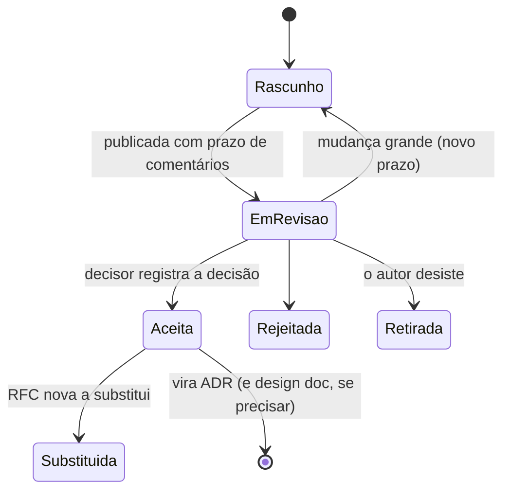

# S7.01 — ADRs e RFCs

> ⏱️ ~1h30 · 🟣 Sênior · Pré-requisitos: ADRs 0001–0029 do PayFlow (escritas desde a J3), J7.09 (revisão de código, descrição de PR), P4.09 (monólito modular), P5.01 (as 5 perguntas antes de dividir), S6.01 (*trade-off* com preço, métrica e data)

> ⚠️ **Verificação:** `lab/DocLab.java` (Java puro, JDK 25.0.5.1) **foi executado** sobre as **33 ADRs reais** de `projeto/adrs/` (as 29 escritas até a S6 e as 4 desta aula) e sobre as RFCs de exemplo (boa, ruim e **mutantes**). O *linter* confere **forma** (campos, dono, data, vocabulário), **nunca** se a decisão está certa. Os fatos sobre o formato de Nygard, o MADR, o DACI, o processo de JEPs e a RFC 2119 foram **conferidos nas páginas** citadas. **NÃO executado:** nenhum processo com pessoas (prazo de comentários, reunião de decisão); a RFC-0001 é **proposta** e o decisor é você.

## 🎯 Objetivos
Ao final desta aula você consegue:
- **Escrever** uma ADR curta (contexto, opções, decisão, status, consequências **positivas e negativas**, gatilho de revisão) que registra **uma** decisão.
- **Conduzir** uma RFC do rascunho à decisão: prazo de comentários, **um** decisor (DACI), alternativas incluindo "não fazer nada" e a ADR resultante.
- **Escolher** entre ADR, RFC, design doc e descrição de PR pelo **tamanho e reversibilidade** da decisão.
- **Verificar por máquina** o que é verificável (campos, índice, prazos) e dizer o que a máquina **não** vê.

## 🤔 Por que isso importa
O PayFlow chegou à S7 com **259 decisões numeradas** e **29 ADRs**. Daqui a um ano alguém vai perguntar "por que o *job* de recorrência não é um serviço?" ou "por que o Multi-AZ custa US$ 183 por mês?". Sem registro, sobram duas saídas ruins, nas palavras de Michael Nygard: **aceitar às cegas** ou **mudar às cegas**. No nível sênior, sua influência passa a ser medida pelas decisões que **você conduz** e que **sobrevivem à sua ausência**: quem decidiu, com que informação, o que foi descartado e **quando revisar**. A ADR registra o que foi decidido; a RFC é **como** se chega lá quando a decisão afeta outras pessoas.

## 💡 Intuição (explicação simples)
Pense num **condomínio**. A **ata da assembleia** (ADR) diz o que foi decidido, por quê, quem votou e o que foi recusado; ninguém reescreve a ata antiga: se mudar de ideia, faz **outra** assembleia e outra ata que **substitui** a anterior. O **edital de convocação** (RFC) vem **antes**: descreve a proposta, as alternativas e o prazo para os moradores mandarem objeções, e diz **quem bate o martelo**. Edital sem prazo vira discussão eterna; ata sem os votos contrários vira folclore.

## 🔬 Como funciona por dentro

### 1. A ADR (Nygard, 2011)
O formato original tem **título, contexto, decisão, status e consequências**, e uma regra que importa mais que o formato: **"One ADR describes one significant decision"**. O status vai de *proposed* a *accepted*; uma ADR que muda a anterior a marca como *deprecated* ou *superseded*. A ADR aceita **não se edita**: decisão nova = ADR nova que aponta a antiga.

| Campo | O que escrever | Armadilha |
|---|---|---|
| Contexto | **fatos** e forças (prazo, custo, SLO, time), sem opinião | contexto que já defende a decisão |
| Opções | **≥ 2**, sempre com "não fazer nada" quando couber | uma opção só = decisão já tomada |
| Decisão | voz ativa, "vamos…" | "talvez", "a princípio" |
| Status | `proposta`, `aceita`, `rejeitada`, `substituída`, `obsoleta` | "aprovada", "ok", "feito" |
| Consequências | **(+) e (−)** | só (+) = propaganda |
| Revisar quando | gatilho **verificável** (número, data, evento) | "quando necessário" |

O **MADR** (*Markdown Architectural Decision Records*) é a variante mais usada: acrescenta *Decision Drivers* e *Considered Options*. O formato do PayFlow (desde a ADR 0001) é parecido: **Status, Contexto, Opções, Decisão, Consequências** e, desde a 0012, **revisão prevista**.

**O que merece ADR:** decisão **cara de reverter** ou que **muda a estrutura** (dados, fronteiras, protocolos, fornecedor, segurança, custo recorrente) ou que **outro time vai herdar**. Escolher um nome de variável não merece; escolher `UUIDv7` como id de todas as tabelas (ADR 0002) merece.

### 2. A RFC: decidir em público antes de decidir
*Request for Comments* nasceu no IETF (a RFC 2119 é a que define o sentido de **MUST**, **SHOULD** e **MAY**, útil para escrever requisitos sem ambiguidade). Em times de produto, RFC é a **proposta escrita posta em revisão** antes da decisão. O próprio Java decide assim: o **JEP 1** descreve estados como *Draft*, *Posted*, *Submitted*, *Candidate*, *Funded* e *Completed*. Rust (RFCs) e Kubernetes (KEPs) têm processos públicos parecidos.



Quem decide? O **DACI** separa papéis: **D**river (conduz, cobra o prazo), **A**pprover (**uma** pessoa: "*yes: one!*"), **C**ontributors (têm voz, não voto) e **I**nformed. Duas pessoas "aprovando" é ninguém decidindo. Uma alternativa descentralizada é o ***advice process*** (Andrew Harmel-Law, no site do Fowler): **qualquer pessoa pode tomar uma decisão de arquitetura**, desde que antes **consulte** quem será afetado e quem tem experiência no assunto, e registre a decisão (ADR). Funciona bem com times maduros e ADRs bem escritas; mal usado vira "eu decidi e avisei".

### 3. ADR × RFC × design doc × descrição de PR
| Artefato | Responde | Tamanho | Quando |
|---|---|---|---|
| Descrição de PR (J7.09) | o que muda neste código | parágrafos | decisão **local e reversível** |
| **ADR** | **o que** decidimos e **por quê** | 1 página | toda decisão significativa (inclusive as tomadas sem RFC) |
| **RFC** | **devemos** fazer isso? qual opção? | 1–3 páginas | afeta outros times, é cara de reverter ou é polêmica |
| **Design doc** (S7.02) | **como** vamos construir | 5–15 páginas | depois (ou junto) de uma RFC aceita, quando o "como" tem riscos |

Regra prática: **RFC termina em ADR**. A RFC guarda a discussão; a ADR guarda o resultado em uma página que alguém lê em 3 minutos.

## 🛠️ Exemplo prático

### 1. As ADRs do próprio PayFlow passam no *linter*?
```bash
cd lab && export JAVA_HOME=/usr/lib/jvm/java-25-openjdk-amd64
$JAVA_HOME/bin/java DocLab.java adr ../../../projeto/adrs
```

```text
ADR  | words | rules | findings
0001 |   236 |     3 | W no-review-trigger
0002 |   219 |     0 | W no-review-trigger
0003 |   185 |     0 | W no-review-trigger
0004 |   223 |     0 | W no-review-trigger
0005 |   281 |     0 | W no-review-trigger
0006 |   394 |     0 | W no-review-trigger
0007 |   343 |     0 | W no-review-trigger
0008 |   203 |     0 | W no-review-trigger
0009 |   343 |     0 | W no-review-trigger
0010 |   536 |     0 | W no-review-trigger
0011 |   662 |     0 | W no-review-trigger
0012 |   523 |     0 | OK
0013 |   611 |     0 | OK
0014 |  1399 |     9 | W bundle
0015 |  1142 |    11 | W bundle
0016 |  1140 |    11 | W bundle
0017 |  1214 |    10 | W no-review-trigger, W bundle
0018 |  1370 |    11 | W no-review-trigger, W bundle
0019 |   871 |     9 | W no-review-trigger, W bundle
0020 |  1592 |     8 | W no-review-trigger, W bundle
0021 |  1517 |     8 | W no-review-trigger, W bundle
0022 |  1606 |     7 | W no-review-trigger, W bundle
0023 |   370 |     0 | W no-negative-consequence, E index-cells=2
0024 |  1334 |    14 | W bundle, E index-cells=2
0025 |  1172 |     8 | W bundle, E index-cells=2
0026 |  1767 |    10 | W bundle
0027 |  1012 |    12 | W bundle, E index-cells=2
0028 |  1405 |    13 | W bundle, E index-cells=2
0029 |  1568 |    15 | W bundle, E index-cells=2
0030 |   340 |     0 | OK
0031 |   262 |     0 | OK
0032 |   264 |     0 | OK
0033 |   272 |     0 | OK

ADRs: 33 · bundles (> 3 rules or > 800 words): 15

Result: 6 error(s), 33 warning(s) -> FAIL
```

**Como ler (e o que a leitura achou):**
1. **6 erros reais no índice:** as linhas das ADRs 0023, 0024, 0025, 0027, 0028 e 0029 em `projeto/adrs/README.md` têm **2 colunas** (falta "Módulo" e "Status"). Ninguém percebeu em 6 módulos porque **ninguém lê índice**: é o tipo de erro que só uma verificação automática pega. Pela regra do treinamento, **não corrigi** módulos anteriores: está em **Correções pendentes** e é o exercício 2.
2. **15 "ADRs-ônibus":** a partir da 0014, cada módulo passou a gerar **uma** ADR com **7 a 15 regras** e mais de 1.000 palavras. Isso contraria a regra de Nygard ("uma decisão por ADR") e tem custo: para **substituir** a regra 8 da ADR 0029, você teria de substituir a ADR inteira ou criar uma exceção parcial confusa. Os limites do *linter* (**3 regras ou 800 palavras**) são **proposta**, não norma.
3. **`no-review-trigger` tem um falso positivo:** a ADR 0001 **tem** gatilho ("revisitar se o negócio exigir partidas dobradas…"), mas **dentro** das consequências, não num campo. O *linter* cobra **forma**; decida se a forma vale a regra (aqui vale: gatilho num campo próprio é achado por máquina).
4. **`no-negative-consequence` na 0023:** ela diz "custos: …" em vez de "(−)". A informação existe; a **convenção** não foi seguida.
5. **As 4 ADRs desta S7 (0030–0033) passam:** uma decisão cada, 262 a 340 palavras, com "(−)" e "Revisar quando". O resultado continua **FAIL** por causa das 6 linhas antigas do índice: o *linter* não deixa o problema velho sumir só porque o novo está certo.

### 2. Uma RFC boa, uma ruim e dois mutantes
A RFC-0001 do PayFlow (**Transferências recorrentes**) está em [`lab/samples/rfc-0001-transferencias-recorrentes.md`](lab/samples/rfc-0001-transferencias-recorrentes.md): proposta, 4 alternativas (com "não fazer nada" e o **serviço separado do simulado do Pleno**), riscos com dono, perguntas com dono, DACI e prazo.

```bash
$JAVA_HOME/bin/java -Dtoday=2026-11-23 DocLab.java rfc samples/rfc-0001-transferencias-recorrentes.md
$JAVA_HOME/bin/java -Dtoday=2026-11-23 DocLab.java rfc samples/rfc-ruim.md
```

```text
RFC: rfc-0001-transferencias-recorrentes.md (946 words)

Result: 0 error(s), 0 warning(s) -> PASS
```
```text
RFC: rfc-ruim.md (86 words)
E missing-section        riscos
E status                 'aprovada' not in [aceita, em revisão, rascunho, rejeitada, retirada, substituída]
E many-approvers         tech lead, produto e arquitetura
E no-comment-deadline    a review without a date never ends
E alternatives           1 option(s); need >= 2
W no-do-nothing          "não fazer nada" is always an option
W placeholders           2 TODO/TBD/a definir

Result: 5 error(s), 2 warning(s) -> FAIL
```
Um verificador que nunca falhou não prova nada. Dois **mutantes** da RFC boa (`run-all.sh` os gera):
```text
### mutant: good RFC without the Decisor line
RFC: rfc-mutant.md (941 words)
E no-approver            DACI: exactly one Approver ("Decisor")
```
```text
### same good RFC read on 2026-12-10 (comment deadline passed, still 'em revisão')
RFC: rfc-0001-transferencias-recorrentes.md (946 words)
W deadline-passed        2026-12-04 < 2026-12-10: decide or extend
```
O segundo é o caso mais comum na vida real: a RFC que **ninguém decide**. O aviso no CI força a conversa: decidir ou **estender o prazo explicitamente**.

### 3. O *linter* também é código (e tinha dois *bugs*)
Na primeira execução, a RFC boa recebeu `W placeholders` por causa de **"todo mês"** (o `(?i)TODO` casou a palavra portuguesa "todo") e o design doc por causa de **"Método"**: o `\b` do Java, sem `UNICODE_CHARACTER_CLASS`, trata "é" como **não letra** e vê uma fronteira de palavra em "Mé|**todo**". Correção (no código, com o comentário do porquê):
```java
static final Pattern PLACEHOLDER = Pattern.compile("\\b(TODO|TBD)\\b|(?i:\\ba definir\\b)", Pattern.UNICODE_CHARACTER_CLASS);
```
Lição de liderança: quando você impõe uma verificação ao time, **o primeiro falso positivo** custa a confiança de todos no *linter*. Rode-o sobre os documentos **reais** antes de ligar no CI.

## 🏗️ Estudo de caso: as ADRs-ônibus do PayFlow
**Contexto.** O *linter* mostra que, desde a P2, cada módulo gerou **uma** ADR grande. Elas funcionaram como **resumo do módulo**, mas uma pessoa nova que quer saber "por que o *staging* desliga à noite?" precisa ler 1.568 palavras da ADR 0029 para achar a regra 6.

**Opções.** (A) Reescrever as 15 ADRs em ~120 ADRs pequenas; (B) manter tudo como está; (C) **a partir de agora**, **uma decisão por ADR**, e as antigas ficam **imutáveis**, com um índice que aponta "decisão nº → ADR"; (D) desistir de ADRs e usar só o `progresso.md`.

<details><summary>Decisão (proposta) e por quê</summary>

**(C).** Reescrever (A) viola a imutabilidade e gasta dias sem mudar nenhuma decisão; (B) mantém o custo de leitura e impede substituir uma regra isolada; (D) mistura histórico do treinamento com decisões do produto. A S7 passa a criar **ADRs curtas**: **0030** (processo de decisão técnica), **0031** (transferências recorrentes como módulo, **proposta** até a RFC-0001 ser decidida), **0032** (modernização do extrato) e **0033** (IA no desenvolvimento e no produto). O *linter* entra no CI com os limites como **aviso** (W) e os erros de índice como **erro** (E). Decisão 260, ADR 0030.
</details>

## ⚖️ Trade-offs e quando NÃO usar
- **RFC para decisão reversível e local** (nome de pacote, biblioteca de teste num módulo): é burocracia. Uma descrição de PR resolve; se for significativa, uma ADR curta **sem** RFC.
- **RFC atrasa.** Um prazo de comentários de 5 a 10 dias úteis é comum; em incidente ou prazo legal, decida, registre a ADR e **revise depois** (status `aceita` com "revisar em").
- **Consenso ≠ unanimidade.** O decisor decide **depois** de ouvir; esperar que todos concordem dá poder de veto a quem menos se importa.
- ***Advice process*** pressupõe confiança e ADRs lidas; num time com rotatividade alta, um decisor nomeado (DACI) é mais seguro.
- **ADR demais** para decisões triviais enterra as importantes. Se ninguém vai perguntar "por quê?" daqui a um ano, não escreva.

## ⚠️ Erros comuns e boas práticas de produção
- **Editar uma ADR aceita** para "atualizar" a decisão: perde-se o histórico. Crie outra e marque a antiga `substituída por NNNN`.
- **RFC como fato consumado:** o código já está pronto e a RFC é só para "comunicar". O time percebe e para de comentar. Publique **antes** de escrever o código (um *spike* pequeno, S7.02, é permitido).
- **Comentários só no chat:** a decisão muda por uma conversa que não ficou registrada. Resuma no fim da RFC ("comentários que mudaram a proposta").
- **Sem "não fazer nada":** às vezes é a melhor opção (A da RFC-0001 é o plano B real se a RFC for rejeitada).
- **Confiar no *linter*:** ele viu 6 erros de forma e **nenhum** erro de conteúdo. Uma ADR que passa pode estar errada; por isso a revisão de pessoas continua.
- **Mensagem de erro do *linter* no CI** (`Result: 6 error(s), 33 warning(s) -> FAIL`, saída `1`): trate como teste quebrado, não como "documentação opcional".

## 🧩 Exercícios
1. **Fixação.** Por que a regra "uma decisão por ADR" importa mais que o formato? Dê um exemplo com a ADR 0029.
2. **Aplicação no PayFlow.** Leve o processo de decisão para o repositório.
   - [ ] `docs/rfcs/0001-transferencias-recorrentes.md` copiado de `lab/samples/` e **com a sua decisão** registrada na seção "Decisão" quando o prazo acabar;
   - [ ] `projeto/adrs/README.md` **corrigido** (as 6 linhas com 4 colunas) e o `DocLab adr` sem erros;
   - [ ] o `DocLab` (ou um *script* equivalente) no CI, com **erro** para índice/campos e **aviso** para tamanho;
   - [ ] um modelo `docs/rfcs/TEMPLATE.md` com as seções que o *linter* cobra.
3. **Desafio (opcional).** Acrescente ao *linter* a regra "ADR `substituída` precisa apontar uma ADR existente que a substitui" e crie o mutante que a reprova.

<details><summary>Soluções de referência</summary>

1. Uma ADR com 15 regras não pode ser **substituída em parte**: mudar só a política de compromissos (regra 10 da 0029) exige marcar a ADR inteira como substituída ou criar uma exceção que ninguém vai achar. Com uma ADR por decisão, a nova ADR "substitui a 00XX" e o resto continua valendo.
2. Exemplo de linha corrigida: `| [0029](0029-arquitetura-em-nuvem-e-custo-do-payflow.md) | Arquitetura em nuvem e custo: … | S6 | aceita |`. No CI: `java DocLab.java adr projeto/adrs` com `exit 1` reprovando o *job*.
3. Procure no texto do status `substituída por (\d{4})`; confira se o arquivo `\1-*.md` existe; mutante: troque o número por `9999`.
</details>

## 🎤 Na entrevista
1. **"Como você registra decisões de arquitetura?"** *Resposta-modelo:* ADRs curtas, uma decisão por documento, com contexto, opções (inclusive não fazer nada), decisão, consequências negativas e gatilho de revisão; imutáveis: mudou, escrevo outra que substitui. Para decisões que afetam outros times, uma RFC com prazo e um decisor antes, e a ADR no fim.
2. **"O que faz uma RFC dar errado?"** *Resposta-modelo:* não ter prazo nem decisor (vira discussão eterna), ser publicada depois do código (fato consumado), ter uma alternativa só, e decisões que mudam no chat sem registro. Eu ponho prazo, um aprovador e uma seção de decisão que cita os comentários que mudaram a proposta.
3. **"Quando você NÃO escreveria uma ADR?"** *Resposta-modelo:* decisão local e barata de reverter; basta a descrição do PR. ADR é para o que é caro de desfazer ou que outra pessoa vai herdar sem ter estado na conversa.

## 📚 Para ir além
- 📑 **Michael Nygard, *Documenting Architecture Decisions*** (2011): o texto que criou a ADR; leia a parte "one ADR describes one significant decision": https://cognitect.com/blog/2011/11/15/documenting-architecture-decisions
- 📄 **adr.github.io** (organização das ADRs, ferramentas e modelos): https://adr.github.io/ e o **MADR**: https://adr.github.io/madr/
- 💻 **Coleção de modelos de ADR** (Joel Parker Henderson): https://github.com/joelparkerhenderson/architecture-decision-record
- 📄 **Guias de ADR dos provedores** (o mesmo conceito em três sotaques): AWS https://docs.aws.amazon.com/prescriptive-guidance/latest/architectural-decision-records/introduction.html e o processo https://docs.aws.amazon.com/prescriptive-guidance/latest/architectural-decision-records/adr-process.html · Microsoft https://learn.microsoft.com/en-us/azure/well-architected/architect-role/architecture-decision-record · Google Cloud https://cloud.google.com/architecture/architecture-decision-records
- 📑 **Andrew Harmel-Law, *Scaling the Practice of Architecture, Conversationally*** (o *advice process*): https://martinfowler.com/articles/scaling-architecture-conversationally.html
- 📄 **DACI** (Atlassian Team Playbook): https://www.atlassian.com/team-playbook/plays/daci
- 📄 **JEP 1** (o "processo de RFC" do próprio JDK): https://openjdk.org/jeps/1 · **RFC 2119** (MUST/SHOULD/MAY): https://www.rfc-editor.org/rfc/rfc2119 · processos de RFC do Rust https://github.com/rust-lang/rfcs e do Kubernetes https://github.com/kubernetes/enhancements
- 📄 **Thoughtworks Radar: ADRs leves**: https://www.thoughtworks.com/radar/techniques/lightweight-architecture-decision-records
- 📑 *Fundamentals of Software Architecture* (Richards e Ford): capítulo sobre decisões de arquitetura e ADRs.

## ✅ Checklist da aula
- [ ] Rodei o `DocLab adr` nas ADRs reais e expliquei os 6 erros, as 15 ADRs-ônibus e o falso positivo da 0001.
- [ ] Sei a diferença entre ADR, RFC, design doc e descrição de PR, e quando **não** escrever nenhum.
- [ ] Li a RFC-0001 e sei quem é o **decisor**, o **prazo** e as **alternativas**.
- [ ] Vi os mutantes reprovarem o *linter* e os dois *bugs* que ele tinha (`todo`, `Método`).
- [ ] Anotei o que **não** foi executado (processo com pessoas; a decisão da RFC é sua).
