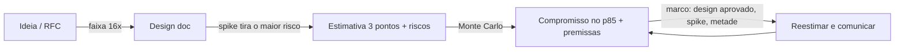

# S7.03 — Estimativas e riscos técnicos

> ⏱️ ~1h30 · 🟣 Sênior (e 🔵 Pleno: fecha a lacuna "estimar tarefas" da matriz) · Pré-requisitos: S7.02 (design doc e *spike* da recorrência), S2.01 (medir antes de afirmar; percentis), S5.07 (régua de probabilidade × impacto), S6.04 (estimativa de custo com premissas visíveis)

> ⚠️ **Verificação:** `lab/EstimateLab.java` (Java puro, JDK 25.0.5.1, sementes fixas: saída determinística) **foi executado**. **Todos os números de entrada são PREMISSAS inventadas e declaradas** (as 11 tarefas, os três pontos de cada uma, os 4 riscos, o histórico de vazão de 12 semanas, o fator de foco de 60%): o laboratório mostra **o método** e **o efeito da forma das distribuições**, não quanto o PayFlow vai levar. O fator de 4× do cone da incerteza foi **conferido** na página da Construx. **NÃO executado:** estimativa com um time real e calibração com histórico real.

## 🎯 Objetivos
Ao final desta aula você consegue:
- **Separar** estimativa, meta e compromisso, e dizer **para que decisão** a estimativa serve.
- **Estimar** uma tarefa e um projeto com **três pontos** e responder com **faixa e confiança** (p50/p85), não com um número.
- **Simular** (Monte Carlo) a soma de tarefas e a previsão por **vazão histórica**, e explicar por que a soma dos "mais prováveis" quase nunca acontece.
- **Manter um registro de riscos** com probabilidade, impacto, dono, gatilho e **mitigação que se paga**.

## 🤔 Por que isso importa
"Quanto tempo leva?" é a pergunta que mais aparece entre engenharia e negócio, e a resposta em **um número** é quase sempre errada **na mesma direção**: para mais. O pleno precisa estimar **uma tarefa** de forma honesta (a lacuna que a matriz do Pleno deixou para esta aula); o sênior precisa estimar **um projeto com vários times e riscos**, dizer **com que confiança**, e mudar a estimativa quando a incerteza cair, sem perder a credibilidade. A RFC-0001 precisa de uma resposta: o decisor só aprova se souber o custo em **semanas de pessoas** (o custo real da S7.02).

## 💡 Intuição (explicação simples)
Pergunte a alguém quanto tempo leva para ir ao aeroporto. "Uns 40 minutos" é o **mais provável**. Mas o trânsito **nunca** faz você chegar em 15 e **às vezes** faz chegar em 90: a distribuição é **torta para a direita**. Se a viagem tem quatro trechos (casa → metrô → trem → ônibus), somar os quatro "mais prováveis" dá uma hora que você **quase nunca** consegue, porque basta **um** trecho dar errado. Quem tem voo marcado sai com a hora do **p85**, não com a média. E, se alguém pergunta "dá para chegar às 10h?", a resposta séria é "com 85% de chance, se o trem estiver funcionando".

## 🔬 Como funciona por dentro

### 1. Estimativa, meta e compromisso
| Palavra | É | Quem define |
|---|---|---|
| **Estimativa** | previsão com incerteza ("de 9 a 11 semanas, 85% de chance") | quem faz o trabalho |
| **Meta** | desejo do negócio ("lançar antes do Natal") | negócio |
| **Compromisso** | promessa ("entregamos dia 15") | negociado entre os dois, **escolhendo um percentil** |

Confundir as três é o erro mais caro: a meta vira "estimativa" e o time "se compromete" com um número que ninguém estimou. Martin Fowler resume: estime **quando a estimativa ajuda uma decisão** (priorizar, aprovar, coordenar times); se nenhuma decisão muda, não gaste o tempo.

### 2. O cone da incerteza
No início (ideia), a estimativa pode errar até **4× para cima ou para baixo** (faixa de 16×, segundo a Construx/McConnell). Ela **estreita** quando o trabalho é definido: requisito, design, *spike*. Consequência prática: **reestime nos marcos** (RFC aceita, design aprovado, *spike* feito) e diga ao negócio **quando** a faixa vai estreitar.

### 3. Três pontos, PERT e a soma que engana
Para cada tarefa: **otimista (o)**, **mais provável (m)**, **pessimista (p)**. A média **PERT** aproxima `(o + 4m + p) / 6`. Como `p` fica longe de `m` (o trânsito), cada distribuição é **assimétrica**, e a soma de 11 tarefas tem mediana **bem acima** da soma dos "mais prováveis". A forma da distribuição (triangular, beta-PERT) é **ela mesma uma premissa**: escreva qual usou.

### 4. Previsão por vazão (sem estimar cada item)
Com histórico de **itens terminados por semana**, sorteie semanas do passado até completar o *backlog* (Monte Carlo) e leia os percentis. Não precisa estimar item a item, mas **precisa** de itens de tamanho parecido e de um histórico **do mesmo time**. O *backlog* **cresce** enquanto você trabalha (itens divididos, descobertos): modele isso.

### 5. Pontos de história e *planning poker* (o que o pleno encontra)
Estimativa **relativa** ("esta é o dobro daquela") em pontos, discutida em grupo com cartas (*planning poker*): a discussão revela premissas diferentes ("você contou a migração?"). Bom para **conversar**; ruim para **converter** em horas ou comparar times. Para **uma tarefa** do pleno, a receita: **quebrar** em passos de no máximo 1–2 dias, **comparar** com tarefas parecidas já feitas, dar **três pontos**, **incluir** teste, revisão, *deploy* e espera, e **dizer** o que ainda é desconhecido.

### 6. Riscos: o que a estimativa não vê
Um risco é um evento **incerto** que, se acontecer, **custa** (tempo, dinheiro, segurança). O registro tem: descrição, **probabilidade**, **impacto**, **exposição = P × I**, **resposta** (evitar, mitigar, transferir, aceitar), **custo da mitigação**, **dono** e **gatilho** (como saberemos que aconteceu). A mitigação **se paga** quando reduz a exposição **mais** do que custa. A régua de severidade da S5.07 é o mesmo raciocínio aplicado a vulnerabilidades.



## 🛠️ Exemplo prático

### 1. As 11 tarefas da recorrência
```bash
cd lab && export JAVA_HOME=/usr/lib/jvm/java-25-openjdk-amd64
$JAVA_HOME/bin/java EstimateLab.java tasks
```

```text
id  | task                                                    |   o |   m |   p | PERT
T1  | V26 + repository + Testcontainers tests                 | 1.0 | 1.5 | 3.0 | 1.67
T2  | recurrence rule + Clock + tests (spike done)            | 0.5 | 1.0 | 2.0 | 1.08
T3  | scheduler: ShedLock, SKIP LOCKED, 2 workers, flag       | 1.0 | 2.0 | 4.0 | 2.17
T4  | execution: transaction, idempotency, business failure   | 2.0 | 3.0 | 8.0 | 3.67
T5  | API: POST/GET/DELETE, policy, MFA, Problem Details      | 2.0 | 3.0 | 6.0 | 3.33
T6  | consent + audit trail (V25)                             | 1.0 | 1.5 | 3.0 | 1.67
T7  | events + notification consumer                          | 1.0 | 2.0 | 4.0 | 2.17
T8  | metrics, alerts, runbook, promtool tests                | 1.0 | 2.0 | 4.0 | 2.17
T9  | load test of the 06:00 peak (k6)                        | 1.0 | 1.5 | 4.0 | 1.83
T10 | security review + threats.csv                           | 0.5 | 1.0 | 3.0 | 1.25
T11 | rollout: internal accounts, reconciliation              | 1.0 | 2.0 | 3.0 | 2.00
Sum: optimistic 12.0 | most likely 20.5 | PERT means 23.0 | pessimistic 44.0 (ideal days)

Monte Carlo, 100,000 runs, tasks only (triangular, independent, seed 7):
  p50 25.4 | p85 27.8 | p95 29.3 ideal days; P(total <= sum of most likely 20.5) = 0.8%
With the 4 risks of the register (not mitigated): p50 29.3 | p85 33.3 | p95 35.6
With mitigations paid up front:                 p50 28.1 | p85 31.3 | p95 33.5

Calendar (focus factor 60%, 1 person, 5-day weeks): p85 31.3 ideal days -> 52.2 working days -> 10.4 weeks
Two people do not halve it: T3 before T4 and T5 before T6 are sequential; review and rollout are waits (premise).
```
**Como ler:**
1. **A soma dos "mais prováveis" (20,5 dias) tem 0,8% de chance** nessas premissas. Quem responde "uns 20 dias" está prometendo o cenário em que **nada** atrasa.
2. **PERT (23,0) × Monte Carlo triangular (p50 25,4):** as duas são "médias razoáveis" e diferem em 10%, porque a triangular dá mais peso às caudas. A escolha da distribuição é premissa: **escreva qual usou**.
3. **Riscos movem a cauda:** o registro de 4 riscos sobe o p85 de 27,8 para 33,3; mitigar **antes** (custando 1,5 dia) traz para 31,3.
4. **Dia ideal ≠ dia de calendário:** com 60% de foco (reuniões, suporte, plantão), o p85 vira **~10 semanas** de uma pessoa. Este é o número para a RFC, **com as premissas**.
5. **A independência é otimista:** se uma surpresa atrasa T4, provavelmente atrasa T3 (mesma pessoa, mesmo código). Tarefas correlacionadas **alargam** a cauda; o modelo não as correlaciona (limitação dita).

### 2. O registro de riscos
```bash
$JAVA_HOME/bin/java EstimateLab.java risks
```

```text
id | risk                                                              |  P   | impact | exposure | mitigation                         | cost   | P after | exp. after | owner
R2 | transfer does not return the existing transfer for a repeated key | 0.40 |  4.0 d |   1.60 d | read the code + one test           | 0.25 d |  0.10   |   0.40 d   | tech lead
R1 | business exception leaves the tx rollback-only                    | 0.30 |  3.0 d |   0.90 d | test first (half a day)            | 0.50 d |  0.05   |   0.15 d   | tech lead
R4 | waiting for the notifications service team (other deploy)         | 0.30 |  3.0 d |   0.90 d | agree the event contract in week 1 | 0.25 d |  0.15   |   0.45 d   | tech lead
R3 | security review changes the consent flow                          | 0.25 |  2.0 d |   0.50 d | review the STRIDE draft early      | 0.50 d |  0.15   |   0.30 d   | security
Total exposure 3.90 d -> 1.30 d after mitigations that cost 1.50 d (net gain 1.10 d)
  R2: mitigation PAYS (expected gain +0.95 d)
  R1: mitigation PAYS (expected gain +0.25 d)
  R4: mitigation PAYS (expected gain +0.20 d)
  R3: mitigation does not pay (expected gain -0.30 d)
Chance that NONE of the 4 risks happens: 22.1% (simulated; formula 22.0%)
p95 - p50 with risks: 6.3 d (the tail that a single number hides)
```
- **R2 é o mais exposto e o mais barato de mitigar:** ler o código do `transfer` e escrever **um** teste custa um quarto de dia e responde a pergunta em aberto do design doc. É o primeiro item da semana 1.
- **R3 "não se paga" em valor esperado** (−0,30 dia) e ainda pode valer: ele reduz a **variância** e um consentimento errado é risco **regulatório** (S5.05), não só de prazo. O número informa; **a decisão é sua**, e fica escrita.
- **Só 22% de chance de nenhum risco acontecer:** o plano que supõe "tudo certo" é o caso **raro**.

### 3. "Quando terminam estes 30 itens?" por vazão
```bash
$JAVA_HOME/bin/java EstimateLab.java forecast
```

```text
History (items/week, synthetic): [3, 5, 2, 6, 4, 4, 1, 5, 3, 6, 4, 2], average 3.75
Average-based answer: 30 / 3.75 = 8.0 weeks
Monte Carlo (resampling weeks, 100,000 runs, backlog 30): p50 8 | p85 10 | p95 11 weeks; P(> 8 weeks) = 45.4%
Monte Carlo (resampling weeks, 100,000 runs, backlog 36 = 30 + 20% split/discovered): p50 10 | p85 11 | p95 12 weeks; P(> 8 weeks) = 89.7%
```
A conta "30 ÷ média" dá **8 semanas** e acerta só a **mediana**: **45%** de chance de atrasar. Se o *backlog* crescer 20% enquanto o time trabalha (normal), a mesma promessa atrasa em **90%** dos cenários. Responda com o **p85** e diga a premissa de crescimento.

## 🏗️ Estudo de caso: "a diretoria quer uma data"
**Contexto.** O produto quer anunciar as transferências recorrentes "para o começo de fevereiro". Você tem a estimativa acima (p85 ~10 semanas para uma pessoa, contando a partir do design aprovado), o registro de riscos e outras prioridades no *backlog* (S7.06).

**Opções.** (A) Aceitar fevereiro e "dar um jeito"; (B) recusar e dizer "fica pronto quando ficar"; (C) devolver **faixa, confiança e alavancas**: o que cabe em fevereiro (um **corte de escopo** com os não-objetivos), o que muda a data (mitigar R2 e R4 na semana 1, segunda pessoa nas tarefas paralelas T7–T9) e **quando** a estimativa estreita (depois do *spike* de R1/R2).

<details><summary>Decisão (proposta) e por quê</summary>

**(C).** (A) transforma meta em compromisso sem estimativa e cobra a conta em qualidade (o caminho do dinheiro, onde o erro é SEV1). (B) é tecnicamente honesto e politicamente inútil: o negócio precisa planejar. A resposta sênior: "**com 85% de confiança, ~10 semanas para uma pessoa a partir do design aprovado; se resolvermos R2 e o contrato com notificações na primeira semana, reestimo em 2 semanas e a faixa estreita; para fevereiro, posso entregar a v1 só para contas internas**". Registre a estimativa **com as premissas** em `docs/design/recorrentes-estimativa.md`. Decisões 263 e 264.
</details>

## ⚖️ Trade-offs e quando NÃO usar
- **Estimar tudo, sempre:** se a decisão não muda (o item vai ser feito de qualquer jeito, é pequeno), estimar é desperdício. Use a **vazão** e acompanhe.
- **Monte Carlo com entradas chutadas** dá números com casas decimais e **falsa precisão**. O valor está em mostrar a **forma** (a cauda, a chance da soma dos "mais prováveis"), não no 27,8.
- ***Story points* como métrica de desempenho:** os pontos inflam e a conversa morre. Use-os para conversar, nunca para comparar pessoas ou times.
- **Margem escondida** (multiplicar por 2 em silêncio): o negócio descobre, desconta, e a confiança acaba. Mostre a margem como **risco com nome**.
- **Mais gente para recuperar prazo:** tarefas sequenciais (T3 → T4) e o tempo de quem chega (contexto, revisão) **não** encolhem; a "lei de Brooks" do *The Mythical Man-Month* é o nome clássico disso.

## ⚠️ Erros comuns e boas práticas de produção
- **Responder com um número** ("20 dias"): responda com **faixa, confiança e premissas**.
- **Esquecer o que não é código:** revisão, teste de carga, revisão de segurança, *rollout* gradual, espera por outro time. No exemplo, T8–T11 são 6,5 dos 20,5 dias "mais prováveis" (32%).
- **Não reestimar:** a estimativa do início do projeto é a **pior** que você vai ter. Reestime nos marcos e **comunique a mudança cedo** (más notícias cedo são baratas).
- **Riscos sem dono nem gatilho:** viram lista de preocupações. Cada linha tem quem acompanha e **como saberemos** que aconteceu.
- **Confundir risco com problema:** se já aconteceu, é **problema** (vai para o plano), não risco.

## 🧩 Exercícios
1. **Fixação.** Por que a soma dos "mais prováveis" tem só 0,8% de chance no laboratório? O que mudaria se todas as tarefas fossem simétricas (`p − m = m − o`)?
2. **Aplicação no PayFlow.** Estime as transferências recorrentes **com os seus números**.
   - [ ] `docs/design/recorrentes-estimativa.md` com as tarefas (três pontos **seus**), a distribuição usada, p50/p85/p95, fator de foco e **premissas**;
   - [ ] `docs/riscos.csv` (id, risco, P, impacto, exposição, resposta, custo, dono, gatilho, revisão) com os 4 riscos e **pelo menos 2 seus**;
   - [ ] a RFC-0001 cita a estimativa (p85) na seção de decisão;
   - [ ] uma data de **reestimativa** marcada (depois do teste de R1/R2).
3. **Desafio (opcional).** Acrescente correlação ao `EstimateLab` (um fator de "semana ruim" que multiplica todas as tarefas de uma execução) e compare o p95.

<details><summary>Soluções de referência</summary>

1. Cada tarefa tem a cauda direita mais longa (`p − m` > `m − o`, ex.: T4 com 3 → 8): a soma tende a ficar **acima** da soma dos modos, e todas precisam sair ao mesmo tempo no lado bom. Com distribuições simétricas, a soma das modas seria a **mediana** da soma (~50%).
2. Exemplo de linha de `riscos.csv`: `R2,transfer não devolve a existente para chave repetida,0.40,4d,1.6d,mitigar,0.25d,tech lead,teste T-idem falha,2026-12-01`.
3. Com um fator comum (ex.: ×1,0 a ×1,3 por execução), as tarefas deixam de "se compensar" e o p95 sobe mais que o p50: a cauda engorda.
</details>

## 🎤 Na entrevista
1. **"Como você estima uma tarefa?"** *Resposta-modelo:* quebro em passos de um ou dois dias, comparo com tarefas parecidas que já fiz, dou otimista, mais provável e pessimista, incluo teste, revisão e *deploy*, e digo o que ainda não sei. Se a incerteza for grande, proponho um *spike* curto antes de me comprometer.
2. **"E um projeto de vários meses?"** *Resposta-modelo:* três pontos por item e uma simulação (ou a vazão histórica do time), respondo com faixa e confiança, por exemplo o p85, com premissas e riscos escritos, e reestimo nos marcos. Nunca somo os "mais prováveis": no meu exemplo essa soma tinha menos de 1% de chance.
3. **"Como você gerencia riscos técnicos?"** *Resposta-modelo:* registro com probabilidade, impacto, dono e gatilho; ataco primeiro o que tem mais exposição e mitigação barata, normalmente com um *spike* ou um teste na primeira semana; reviso o registro a cada marco.

## 📚 Para ir além
- 📄 **Construx: o cone da incerteza** (4× para cima e para baixo no início): https://www.construx.com/books/the-cone-of-uncertainty/
- 📑 **Martin Fowler, *PurposeOfEstimation***: estimar quando ajuda uma decisão: https://martinfowler.com/bliki/PurposeOfEstimation.html
- 📄 **Estimativa de três pontos** e **PERT** (fórmulas): https://en.wikipedia.org/wiki/Three-point_estimation e https://en.wikipedia.org/wiki/Program_evaluation_and_review_technique
- 📄 ***Planning poker*** (Mountain Goat Software): https://www.mountaingoatsoftware.com/agile/planning-poker
- 📄 **Falácia do planejamento** (por que subestimamos): https://en.wikipedia.org/wiki/Planning_fallacy
- 💻 **Focused Objective** (Troy Magennis: planilhas de previsão por Monte Carlo com vazão): https://www.focusedobjective.com/
- 📑 *Software Estimation: Demystifying the Black Art* (Steve McConnell): estimativa × meta × compromisso, cone da incerteza. Citado de memória, **não conferido**.
- 📑 *The Mythical Man-Month* (Fred Brooks): por que mais gente não encurta o prazo na mesma proporção. Citado de memória.

## ✅ Checklist da aula
- [ ] Sei separar estimativa, meta e compromisso, e respondo com **faixa, confiança e premissas**.
- [ ] Rodei os três modos do `EstimateLab` e expliquei os 0,8%, o efeito dos riscos e os 45% × 90% da vazão.
- [ ] Sei estimar **uma tarefa** (a lacuna do Pleno) e **um projeto** (Monte Carlo ou vazão).
- [ ] Mantenho um registro de riscos com dono e gatilho e sei quando a mitigação se paga.
- [ ] Anotei o que **não** foi executado (tudo é premissa; nenhuma estimativa com time real).
