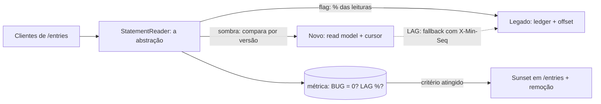

# S7.04 — Dívida técnica e modernização de legado

> ⏱️ ~1h30 · 🟣 Sênior · Pré-requisitos: J7.07 (regra do escoteiro × grande refatoração), J6.06 (`Deprecation` e `Sunset`), P1.11 (o que mudou do Java 8 ao 25), P1.12 (`--add-opens` como dívida), P4.09 ("estrangular por dentro"), P5.02 (estrangulamento em 7 passos e modo sombra), P8.04 (*feature flags*), S1.05 (CQRS do extrato, `X-Min-Seq`), S3.01 (*parallel change*), S7.03 (custo e risco)

> ⚠️ **Verificação:** **executados de verdade** (JDK 25.0.5.1, Maven 3.9.12, git 2.53): `lab/HotspotLab.java` sobre o **histórico real** do `spring-petclinic` (1.047 *commits*, fixado no *commit* `500158f`, só leitura: `git log` e `git show`); `lab/StranglerLab.java` (um **modelo** da troca do extrato, com atraso de projeção aleatório e 2 mutantes do projetor); o **OpenRewrite** real (`rewrite-maven-plugin` 6.46.1, receitas `rewrite-migrate-java` 3.42.1) em modo ***dry run*** sobre o projetinho `lab/legacy-upgrade` (Java 8, `javax.persistence`). Os nomes das receitas foram **conferidos dentro dos JARs** do Maven Central. **NÃO executado:** nada no PayFlow (a troca do extrato é **plano por leitura**), receitas de Spring Boot 3/4 num projeto Spring real, e a contagem de complexidade é uma **aproximação grosseira** (pontos de decisão por expressão regular).

## 🎯 Objetivos
Ao final desta aula você consegue:
- **Classificar** dívida técnica (prudente × imprudente, deliberada × inadvertida) e separar **juros** de **principal**.
- **Medir** onde a dívida custa com o histórico do Git (**hotspots** e **acoplamento de mudança**) e mantê-la num **registro** que o negócio entende.
- **Modernizar sem parar o sistema**: *branch by abstraction*, **leitura em paralelo comparada por versão**, depreciação com `Sunset` e a **remoção** do caminho antigo.
- **Usar refatoração automatizada** (OpenRewrite) para atualizar Java e `javax` → `jakarta`, revisando o que ela **não** faz e a **licença** das receitas.

## 🤔 Por que isso importa
Todo sistema que dá dinheiro vira legado. O PayFlow já tem o seu: o extrato antigo (`GET /api/v1/accounts/{id}/entries`, paginação por *offset* direto no ledger, J6) convive com o novo (`/statement`, CQRS da S1.05); há `--add-opens` (P1.12), *flags* que precisam morrer (P8.04) e as ADRs-ônibus (S7.01). O sênior é quem **dá nome e preço** a isso, **escolhe** o que pagar primeiro e **conduz** a troca sem incidente, e, igualmente importante, **convence** o negócio a financiar (S7.06). "Reescrever do zero" é a proposta mais popular e a que mais falha.

## 💡 Intuição (explicação simples)
Dívida técnica é um **cartão de crédito**: você compra hoje (entrega antes) e paga **juros** em toda compra futura naquela loja (cada mudança naquele código demora mais). Os juros só existem **onde você compra**: dívida num canto que ninguém toca quase não custa. Modernizar sem parar é **trocar o encanamento do prédio com os moradores dentro**: instala o cano novo **ao lado** do velho, liga um de cada vez, compara se a água sai igual e só então **arranca** o velho. Quem esquece o último passo fica com **dois** encanamentos para manter.

## 🔬 Como funciona por dentro

### 1. O quadrante da dívida (Martin Fowler)
| | **Deliberada** | **Inadvertida** |
|---|---|---|
| **Prudente** | "lançamos agora e pagamos depois" (com registro e data) | "agora sabemos como deveria ter sido" (aprendizado) |
| **Imprudente** | "não temos tempo para design" | "o que é camada?" |

A metáfora ajuda a falar com quem não é técnico; o próprio Fowler lembra que **a dívida prudente pode nem valer ser paga** se estiver numa parte do código **raramente tocada**. Por isso, antes de pagar, **meça onde ela é tocada**.

### 2. Medir: hotspots e acoplamento de mudança
- **Hotspot** = arquivo **muito alterado** **e** **complexo** (o que Adam Tornhill chama de "código como cena do crime"). Frequência de mudança vem de graça do Git; complexidade, de qualquer métrica razoável (linhas, indentação, pontos de decisão).
- **Acoplamento de mudança** = arquivos que **mudam juntos** nos mesmos *commits*: um acoplamento que a arquitetura não mostra (ex.: um *controller* que sempre muda junto com outro).
- **Sintomas de juros** que valem registro: tempo de PR naquela área, incidentes e *bugs* ligados a ela, *rollbacks*, "só a Fulana mexe nisso" (risco de pessoas).

### 3. O registro de dívida
`docs/divida-tecnica.csv`: `id, área, descrição, tipo (quadrante), juros (sintoma medido), principal (esforço, faixa), risco, custo do atraso (S7.06), dono, gatilho, revisão`. Sem **juros medidos**, a linha é opinião; sem **dono**, ninguém paga.

### 4. Modernizar: as técnicas
| Técnica | O que faz | Onde já apareceu |
|---|---|---|
| **Estrangulamento** (*strangler fig*) | o novo cresce ao lado e assume aos poucos | P5.02 (serviço de notificações) |
| ***Branch by abstraction*** | uma **abstração** na frente do fornecedor atual; os clientes passam por ela; a implementação nova entra atrás; a velha sai | **nova** |
| ***Parallel change*** (*expand/contract*) | expandir → migrar → contrair, no esquema e nas APIs | S3.01 |
| **Execução em paralelo** (modo sombra) | as duas implementações respondem; **uma** vale; as diferenças são registradas | P5.02, S3.09 |
| **Depreciação com prazo** | `Deprecation` + `Sunset` + métrica de uso do caminho antigo | J6.06 |

O catálogo ***Patterns of Legacy Displacement*** (Thoughtworks, no site do Fowler) dá nome ao resto, como **Transitional Architecture**: "elementos instalados para facilitar a substituição e que pretendemos **remover** quando ela acabar". A abstração e o comparador do extrato são isso: **têm data para morrer**.



### 5. Atualizar a pilha com refatoração automatizada
Mudanças **mecânicas** e repetitivas (Java 8 → 25, `javax` → `jakarta`, Spring Boot 2 → 3 → 4) são feitas por **receitas** do **OpenRewrite**: ele lê o código como árvore com tipos (não por texto) e aplica transformações. As receitas existem nos JARs (`org.openrewrite.java.migrate.UpgradeToJava25`, `org.openrewrite.java.migrate.jakarta.JavaxMigrationToJakarta`; em `rewrite-spring`, `org.openrewrite.java.spring.boot3.UpgradeSpringBoot_3_0` e `org.openrewrite.java.spring.boot4.UpgradeSpringBoot_4_0`). **Licença:** os módulos de receitas `rewrite-migrate-java` e `rewrite-spring` usam a **Moderne Source Available License** (o *plugin* Maven é Apache 2.0). O texto (versão de 13/12/2024) concede uso, cópia, distribuição interna e obras derivadas, e **proíbe** oferecer a terceiros um produto ou serviço que faça o que o software faz. Migrar o **próprio** código parece o caso permitido; **confirme com o jurídico** antes de adotar (governança de dependências, S5.04).

## 🛠️ Exemplo prático

### 1. Hotspots num histórico real
```bash
cd lab && export JAVA_HOME=/usr/lib/jvm/java-25-openjdk-amd64
git clone https://github.com/spring-projects/spring-petclinic.git /tmp/petclinic
$JAVA_HOME/bin/java HotspotLab.java /tmp/petclinic 500158f732419217507c7656904b8e6aa1bcc0d6 src/main/java
```

```text
Repository at 500158f73241: 1047 commits (2013-01-09 .. 2026-09-29); 30 files under 'src/main/java' alive at the commit; 25 commits with > 20 files ignored for coupling

Top 8 by revisions only (what 'git log | sort' shows):
   52 revs    19 decisions  …/owner/PetController.java
   52 revs    10 decisions  …/owner/OwnerController.java
   42 revs     4 decisions  …/owner/VisitController.java
   39 revs    14 decisions  …/owner/Owner.java
   38 revs     0 decisions  …/owner/Pet.java
   34 revs     0 decisions  …/owner/Visit.java
   32 revs     2 decisions  …/vet/VetController.java
   27 revs     0 decisions  …/owner/OwnerRepository.java

Top 8 hotspots (revisions x decision points):
  revs | churn | LOC | decisions | score | file
    52 |   893 | 147 |        19 |   988 | …/owner/PetController.java
    39 |   948 | 116 |        14 |   546 | …/owner/Owner.java
    52 |   980 | 129 |        10 |   520 | …/owner/OwnerController.java
    42 |   598 |  64 |         4 |   168 | …/owner/VisitController.java
    19 |   187 |  29 |         6 |   114 | …/owner/PetValidator.java
    32 |   337 |  48 |         2 |    64 | …/vet/VetController.java
    19 |   250 |  29 |         3 |    57 | …/owner/PetTypeFormatter.java
    38 |   677 |  48 |         0 |    38 | …/owner/Pet.java

Concentration: top 3 of 30 files (10%) = 25% of all revisions of alive files

Change coupling (pairs changed together in >= 8 commits; degree = shared / revisions of the less changed file):
   21 shared ( 40%)  …/owner/OwnerController.java <-> …/owner/PetController.java
   16 shared ( 38%)  …/owner/OwnerController.java <-> …/owner/VisitController.java
   15 shared ( 36%)  …/owner/PetController.java <-> …/owner/VisitController.java
   12 shared ( 35%)  …/owner/Pet.java <-> …/owner/Visit.java
    8 shared ( 21%)  …/owner/OwnerController.java <-> …/owner/Pet.java
    8 shared ( 21%)  …/owner/Owner.java <-> …/owner/Pet.java
```
**Como ler:**
1. **Só revisões engana:** `Pet.java` tem 38 revisões e **0** pontos de decisão (uma entidade que muda quando muda o modelo); é mudança **barata**. O ranking por revisão × decisões põe `PetController`, `Owner` e `OwnerController` no topo: é ali que um *bug* novo tem mais chance de nascer.
2. **Acoplamento de mudança:** os três *controllers* do pacote `owner` mudam juntos em 36–40% das vezes. Pode ser saudável (uma funcionalidade nova atravessa os três) ou um sinal de lógica duplicada. **O Git aponta; a leitura do código decide.**
3. **O histórico segue renomeações** (`git log -M` e o mapa de nomes antigos do `HotspotLab`); *commits* gigantes (renomeação de pacote, formatação) são **excluídos** do acoplamento, senão tudo parece acoplado a tudo.
4. **Limites:** é um projeto de exemplo com 30 arquivos e muitos colaboradores ocasionais; os "pontos de decisão" contam `if`, `for`, `&&`, `?` por texto (um `<?>` de *generics* conta como decisão). Use o **ranking**, não o número absoluto.

### 2. A troca do extrato com leitura em paralelo (modelo)
```bash
$JAVA_HOME/bin/java StranglerLab.java
```

```text
[correct] 24,390 ledger entries, 12,100 reads in parallel (10 simulated minutes, mean projector lag 150 ms)
  naive equals()      :  1403 different (11.6%)
  version-aware LAG   :  1403 (11.6%) -> expected, transient (would be a fallback with X-Min-Seq)
  version-aware BUG   :     0
  0 bugs in 12,100 reads -> 95% upper bound on the bug rate = 3/n = 0.025% (rule of three)
  a bug that hits 1 read in 1,000 would show up at least once with probability 100.0%
  a bug that hits 1 read in 10,000 would show up at least once with probability 70.2%
  a bug that hits 1 read in 100,000 would show up at least once with probability 11.4%

[m1] 24,390 ledger entries, 12,100 reads in parallel (10 simulated minutes, mean projector lag 150 ms)
  naive equals()      : 12028 different (99.4%)
  version-aware LAG   :    38 (0.3%) -> expected, transient (would be a fallback with X-Min-Seq)
  version-aware BUG   : 11990  (first at read #35)

[m2] 24,390 ledger entries, 12,100 reads in parallel (10 simulated minutes, mean projector lag 150 ms)
  naive equals()      :  8216 different (67.9%)
  version-aware LAG   :   475 (3.9%) -> expected, transient (would be a fallback with X-Min-Seq)
  version-aware BUG   :  7741  (first at read #46)
```
O código do modelo usa a **abstração** que dá nome à técnica:
```java
/** The abstraction both implementations live behind (branch by abstraction). */
interface StatementReader { List<Entry> lastEntries(int account, int limit, long now); }
```
**O que o modelo ensina:**
1. **A comparação ingênua grita com o projetor CORRETO:** 11,6% de "diferenças" que são só **atraso** (a projeção é assíncrona, decisão 188). Um time que liga o modo sombra com `equals()` aprende a **ignorar** o alarme, e aí não vê o *bug*.
2. **Comparar por versão** (só o que os dois já viram: `seq ≤ maxSeq` do novo) separa **LAG** (esperado; com `X-Min-Seq` vira *fallback* ao ledger, S1.05) de **BUG**.
3. **Os mutantes aparecem rápido:** **m1** deduplica por `transfer_id` (os depósitos têm `transfer_id` nulo, ADR 0001, e somem); **m2** aceita lacunas e calcula o saldo na ordem de **chegada** (a regra "lacuna = erro" da decisão 188 existe por isso).
4. **Quanto tempo de paralelo basta?** Com **0** *bugs* em *n* leituras, a **regra de três** diz que a taxa real é **< 3/n** com 95% de confiança (aqui, < 0,025%). E um *bug* que acerta 1 leitura em 100 mil tem só **11,4%** de chance de aparecer em 12 mil leituras: **o critério de desligar o velho é um número de leituras, não um número de dias**.

### 3. OpenRewrite num projeto "legado" (*dry run*: não altera arquivos)
```bash
cd lab/legacy-upgrade
mvn -B org.openrewrite.maven:rewrite-maven-plugin:6.46.1:dryRun \
  -Drewrite.recipeArtifactCoordinates=org.openrewrite.recipe:rewrite-migrate-java:3.42.1 \
  -Drewrite.activeRecipes=org.openrewrite.java.migrate.UpgradeToJava25
```
O *patch* gerado (`target/rewrite/rewrite.patch`; cópia em `lab/out-s704-rewrite-UpgradeToJava25.patch`), trecho:
```diff
-    <maven.compiler.source>1.8</maven.compiler.source>
-    <maven.compiler.target>1.8</maven.compiler.target>
+    <maven.compiler.source>25</maven.compiler.source>
+    <maven.compiler.target>25</maven.compiler.target>
```
```diff
-        tiers.add(new Integer(100));
-        tiers.add(new Integer(500));
+        tiers.add(Integer.valueOf(100));
+        tiers.add(Integer.valueOf(500));
         return Collections.unmodifiableList(tiers);
     }
 
     public static String describe(Object value) {
-        if (value instanceof String) {
-            String s = (String) value;
+        if (value instanceof String s) {
```
E com `JavaxMigrationToJakarta` (`lab/out-s704-rewrite-JavaxMigrationToJakarta.patch`):
```diff
-      <groupId>javax.persistence</groupId>
-      <artifactId>javax.persistence-api</artifactId>
-      <version>2.2</version>
+      <groupId>jakarta.persistence</groupId>
+      <artifactId>jakarta.persistence-api</artifactId>
+      <version>3.0.0</version>
```
```diff
-import javax.persistence.Entity;
-import javax.persistence.Id;
-import javax.persistence.Table;
+import jakarta.persistence.Entity;
+import jakarta.persistence.Id;
+import jakarta.persistence.Table;
```
**O que a execução mostrou (e a leitura não mostraria):**
1. `UpgradeToJava25` **não** tocou em `javax.persistence` (é outra receita), **nem** em `StringBuffer`, no `new ArrayList<Integer>()` sem *diamond* ou no `Collections.unmodifiableList`. Receita faz **o que diz**, não "moderniza tudo".
2. Ela mudou `source`/`target` para 25, mas **não** trocou por `maven.compiler.release` (o que o PayFlow usa).
3. `JavaxMigrationToJakarta` escolheu **`jakarta.persistence-api` 3.0.0** (a do Jakarta EE 9); o Spring Boot 4.1.2 gerencia a **3.2.0**. Num projeto Boot, **apague** a versão e deixe o BOM decidir.
4. Use **uma receita por PR**, com a suíte verde **antes** e **depois**; o *dry run* vira o *diff* que o revisor lê.

## 🏗️ Estudo de caso: "vamos reescrever o extrato do zero?"
**Contexto.** O extrato antigo (`/entries`, *offset* sobre o ledger) é lento em contas grandes e tem a deriva de paginação sob escrita (ADR 0008). Um dev propõe **reescrever** o módulo inteiro "do jeito certo" num *branch* de 2 meses.

**Opções.** (A) Reescrita no *branch* longo e troca num dia; (B) não fazer nada; (C) **estrangular**: a abstração `StatementReader`, o `/statement` (S1.05) atrás dela, leitura em paralelo **por versão** com métrica, *rollout* por *flag* (1% → 10% → 50% → 100%), `Deprecation`/`Sunset` no `/entries` com métrica de uso, **remoção** com data.

<details><summary>Decisão (proposta) e por quê</summary>

**(C).** A reescrita (A) congela o código antigo por 2 meses (*bugs* corrigidos nele precisam ser refeitos no novo), troca **tudo de uma vez** (sem comparação nem volta gradual) e o *branch* longo briga com o fluxo de *branches* curtos (S7.05). (B) mantém a deriva e a lentidão. (C) entrega valor a cada passo e tem **critério numérico** para desligar o velho: **0 BUG** na leitura em paralelo depois de **≥ 30 mil leituras** (regra de três: taxa < 0,01% com 95% de confiança), *fallback* (`statement_fallback_total`) abaixo de um limiar acordado, e uso do `/entries` **zero** por 30 dias depois do `Sunset`. A abstração e o comparador são **arquitetura de transição**: a remoção deles está no plano. ADR 0032, decisão 266.
</details>

## ⚖️ Trade-offs e quando NÃO usar
- **Pagar dívida onde ninguém mexe:** os juros são quase zero (o próprio Fowler); a refatoração ainda traz **risco** de regressão. Pague onde o hotspot e os sintomas mostram juros.
- **Estrangulamento custa mais** que a reescrita **no papel** e menos **na prática** (P5.02). Para um componente pequeno, isolado e bem testado, uma troca direta atrás de *flag* pode bastar.
- **Leitura em paralelo dobra a carga** de leitura (e de banco). Amostre (ex.: 10% das leituras) e limite pelo orçamento de conexões (decisão 181).
- **Refatoração automatizada não é revisão:** ela não sabe se o código antigo dependia de um comportamento esquisito. Testes antes, PR pequeno, leitura do *diff*.
- **"20% do tempo para dívida" fixo** é simples e evita a conversa de prioridade, mas paga a dívida **errada** se ninguém medir juros. Prefira itens de dívida **no mesmo *backlog***, com custo do atraso (S7.06), e um piso de capacidade como rede de proteção.

## ⚠️ Erros comuns e boas práticas de produção
- **Nunca remover o caminho antigo:** dois extratos, dois conjuntos de *bugs*, para sempre. A remoção tem **data e dono** no registro de dívida.
- **Modo sombra que escreve:** o caminho novo em sombra **não pode** ter efeito (enviar e-mail, gravar dado de negócio). Só lê e compara (P5.02).
- **Comparar com `equals()` um sistema eventualmente consistente:** 11,6% de falsos alarmes no modelo. Compare **na mesma versão**.
- **Abstração vazada:** se os clientes continuam chamando o `LedgerEntryRepository` direto, a abstração não protege nada. Um teste de arquitetura (P4.10) impede.
- **Dívida invisível:** `--add-opens` no `JAVA_TOOL_OPTIONS` (P1.12), *flags* com mais de 30 dias em 100% (P8.04), a própria abstração de transição. Todos entram no registro.
- **Mensagem que você vai ver** ao rodar uma receita **sem** a coordenada do artefato de receitas (reproduzida no laboratório):
  ```text
  [ERROR] Failed to execute goal org.openrewrite.maven:rewrite-maven-plugin:6.46.1:dryRun (default-cli) on project legacy-upgrade: Execution default-cli of goal org.openrewrite.maven:rewrite-maven-plugin:6.46.1:dryRun failed: Recipe(s) not found: org.openrewrite.java.migrate.UpgradeToJava25
  [ERROR] Did you mean: org.openrewrite.maven.MigrateToMaven4
  ```
  A sugestão "*Did you mean*" é de uma receita **que nada tem a ver**: o *plugin* só conhece as receitas embutidas. Passe `-Drewrite.recipeArtifactCoordinates=...` (como no exemplo) ou declare a dependência no *plugin*.

## 🧩 Exercícios
1. **Fixação.** Classifique no quadrante: (a) o *offset* do `/entries` (J6, ADR 0008 já previa o cursor); (b) o `LoginThrottle` com *check-then-act* (achado da P1); (c) as ADRs-ônibus (S7.01).
2. **Aplicação no PayFlow.** Monte o registro e o plano.
   - [ ] `docs/divida-tecnica.csv` com **pelo menos 6** itens (extrato antigo, `--add-opens`, *flags* vencidas, ADRs-ônibus, índice de ADRs, os do seu hotspot), cada um com juros **medidos ou a medir**, dono e gatilho;
   - [ ] o `HotspotLab` rodado **no repositório `payflow`** (troque o prefixo para `src/main/java/com/payflow`) e os 5 primeiros hotspots no registro;
   - [ ] `docs/modernizacao/plano-extrato.md` com os passos da opção C, o **critério numérico** de desligar o velho e a data de remoção da arquitetura de transição;
   - [ ] o `ParallelStatementReader` **descrito** (compara por versão, amostra 10%, métrica `statement_shadow_total{result="match|lag|bug"}`) e o teste de arquitetura que proíbe chamar o ledger fora da abstração.
3. **Desafio (opcional).** Rode `UpgradeToJava25` e `JavaxMigrationToJakarta` num projeto seu (ou num *fork* do petclinic) em modo *dry run* e liste três coisas que as receitas **não** fizeram.

<details><summary>Soluções de referência</summary>

1. (a) **prudente e deliberada** (a ADR 0008 registrou "offset pagina com deriva; cursor: P2"); (b) **prudente e inadvertida** (aprendemos depois, com o laboratório de concorrência); (c) **prudente e inadvertida** (o formato derivou módulo a módulo; o *linter* mostrou).
2. Linha exemplo: `D1,statement,/entries com offset sobre o ledger,prudente-deliberada,p99 a medir em contas grandes; deriva sob escrita,2-3 semanas,médio,R$ 1,5k/semana (premissa S7.06),tech lead,uso de /entries = 0 por 30 dias,2027-03-01`.
3. Esperado: não troca `source/target` por `release`; não muda `StringBuffer` para `StringBuilder`; não remove a versão explícita em favor do BOM do Boot; não melhora `Collections.unmodifiableList` para `List.copyOf`.
</details>

## 🎤 Na entrevista
1. **"Como você convence o negócio a pagar dívida técnica?"** *Resposta-modelo:* mostro os juros em linguagem de negócio (tempo de entrega naquela área, incidentes, risco), uso o histórico do Git para provar onde ela é tocada, fatio o pagamento para entregar algo em semanas e coloco os itens no mesmo *backlog* com custo do atraso. Dívida em código que ninguém toca eu deixo.
2. **"Reescrever ou estrangular?"** *Resposta-modelo:* quase sempre estrangular: algo novo atrás de uma abstração, comparação em paralelo, migração gradual por *flag* e remoção do velho com critério numérico. Reescrita só para algo pequeno, isolado e bem testado, ou quando a plataforma antiga não roda mais.
3. **"Como garantir que o novo faz o mesmo que o velho?"** *Resposta-modelo:* execução em paralelo comparando na mesma versão dos dados, para não confundir atraso de projeção com *bug*; métrica de concordância; critério de troca por número de leituras sem divergência (regra de três), não por calendário.

## 📚 Para ir além
- 📑 **Martin Fowler, *TechnicalDebtQuadrant*** e ***TechnicalDebt***: https://martinfowler.com/bliki/TechnicalDebtQuadrant.html e https://martinfowler.com/bliki/TechnicalDebt.html
- 📑 ***Patterns of Legacy Displacement*** (Thoughtworks): *Transitional Architecture*, *Legacy Mimic*, *Divert the Flow*: https://martinfowler.com/articles/patterns-legacy-displacement/
- 📑 ***BranchByAbstraction*** e ***ParallelChange***: https://martinfowler.com/bliki/BranchByAbstraction.html e https://martinfowler.com/bliki/ParallelChange.html · ***StranglerFigApplication***: https://martinfowler.com/bliki/StranglerFigApplication.html
- 📄 **OpenRewrite**: https://docs.openrewrite.org/ · receitas `UpgradeToJava25` https://docs.openrewrite.org/recipes/java/migrate/upgradetojava25, `JavaxMigrationToJakarta` https://docs.openrewrite.org/recipes/java/migrate/jakarta/javaxmigrationtojakarta e Spring Boot 4.0 (edição comunitária) https://docs.openrewrite.org/recipes/java/spring/boot4/upgradespringboot_4_0-community-edition (páginas renderizadas por JavaScript: os nomes foram conferidos nos JARs)
- 📄 **Moderne Source Available License** (leia antes de adotar as receitas): https://docs.moderne.io/licensing/moderne-source-available-license
- 📄 **Guia de migração do Spring Boot 4.0**: https://github.com/spring-projects/spring-boot/wiki/Spring-Boot-4.0-Migration-Guide · **guia de migração do JDK 25**: https://docs.oracle.com/en/java/javase/25/migrate/index.html
- 📄 **RFC 9745** (cabeçalho `Deprecation`) e **RFC 8594** (`Sunset`): https://www.rfc-editor.org/rfc/rfc9745.html e https://www.rfc-editor.org/rfc/rfc8594.html
- 📄 **Regra de três** (estatística): https://en.wikipedia.org/wiki/Rule_of_three_(statistics)
- 📑 ***Your Code as a Crime Scene***, 2ª edição (Adam Tornhill): hotspots e acoplamento de mudança: https://pragprog.com/titles/atcrime2/your-code-as-a-crime-scene-second-edition/ · ferramenta **code-maat**: https://github.com/adamtornhill/code-maat
- 💻 **spring-petclinic** (o histórico analisado): https://github.com/spring-projects/spring-petclinic
- 📑 *Working Effectively with Legacy Code* (Michael Feathers) e *Refactoring* (Martin Fowler): pontos de costura, testes de caracterização, refatorações seguras. Citados de memória.

## ✅ Checklist da aula
- [ ] Sei o quadrante da dívida e a diferença entre juros e principal.
- [ ] Rodei o `HotspotLab` num histórico real e expliquei por que "só revisões" engana.
- [ ] Rodei o `StranglerLab` e sei por que comparar **por versão** e decidir por **número de leituras**.
- [ ] Vi o que o OpenRewrite fez **e o que não fez**, e sei qual é a licença das receitas.
- [ ] Anotei o que **não** foi executado (nada no PayFlow; receitas de Spring não rodadas; complexidade aproximada).
