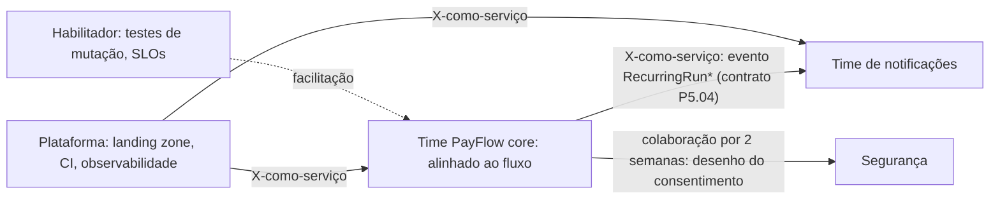

# S7.06 — Comunicação com produto e negócio

> ⏱️ ~1h30 · 🟣 Sênior · Pré-requisitos: S4.01 (política de *error budget*, decisão 219), S5.07 (aceite de risco com aprovador e validade), S6.04 (custo por unidade), S6.06 (postmortem de custo), S7.03 (estimativa com faixa e confiança), S7.04 (registro de dívida, fatiar a troca do extrato)

> ⚠️ **Verificação:** `lab/PriorityLab.java` (Java puro, JDK 25.0.5.1) **foi executado**, inclusive a **força bruta** sobre todas as ordens possíveis (720 e 5.040) para conferir a regra. **Os custos do atraso e as durações são PREMISSAS inventadas e declaradas** (em milhares de reais por semana e semanas de time): o laboratório mostra **o método**, não o valor das funcionalidades do PayFlow. As definições de CD3, os tipos de time e modos de interação do *Team Topologies*, a frase da lei de Conway e a política de *error budget* do *SRE Workbook* foram **conferidos** nas páginas citadas. **NÃO executado:** nenhuma conversa com produto ou diretoria.

## 🎯 Objetivos
Ao final desta aula você consegue:
- **Traduzir** decisões técnicas para produto e negócio em **resultado, dinheiro, risco e prazo**, num *one-pager* com recomendação primeiro.
- **Priorizar** com **custo do atraso** e **CD3**, e mostrar com número por que a ordem importa.
- **Negociar** dívida técnica e confiabilidade usando o *error budget* como **contrato** e fatiando o que não cabe.
- **Trabalhar entre times** escolhendo o **modo de interação** e tratando dependências como contratos.

## 🤔 Por que isso importa
O sênior é a ponte entre "o que o negócio quer" e "o que o sistema aguenta". Os módulos anteriores deixaram várias decisões que **só o negócio pode assinar**: o custo da hora parada que justifica o Multi-AZ (decisão 246), a região (247), o SLO e a política de orçamento de erro (219, "assinada por produto"), o aceite de risco da revisão de segurança (243). Se você chega com "precisamos de Multi-AZ porque é boa prática", perde; se chega com "**+US$ 183/mês** compra a redução de RTO de 2 h para 2 min; vale se uma hora parada custa mais que ~US$ 1.118", o negócio **decide**, e a decisão é dele.

## 💡 Intuição (explicação simples)
Um bom mecânico não diz "a junta homocinética está com folga". Ele diz: "**dá para rodar mais um mês; se estourar na estrada, o conserto fica três vezes mais caro e o carro para; trocar agora custa R$ 800 e leva um dia**". Você decide, porque o dinheiro e o risco são seus. E, se ele tem dez carros na oficina e um elevador só, ele começa pelo que **perde mais dinheiro por dia parado dividido pelo tempo de serviço**: o táxi que conserta em uma hora antes da reforma do carro de passeio que leva uma semana.

## 🔬 Como funciona por dentro

### 1. A mensagem: recomendação primeiro
Executivos leem o começo. Estrutura de um ***one-pager*** (uma página):
1. **Recomendação** (o que você pede, em uma frase: o "BLUF", *bottom line up front*);
2. **Por quê** em resultado de negócio (receita, custo, risco, prazo), **com número e premissa**;
3. **Opções** (incluindo "não fazer"), cada uma com custo, prazo e risco;
4. **O que precisamos de vocês** (decisão, orçamento, prazo, quem assina);
5. **Quando revisitar** (gatilho ou data).

Troque jargão por efeito: "*rollback-only* no `@Transactional`" vira "um erro de saldo poderia cancelar o registro da falha e o cliente não seria avisado; o teste de meio dia elimina isso".

### 2. Custo do atraso e CD3
**Custo do atraso** (*cost of delay*) é quanto se perde **por semana** de atraso de um item (receita que não entra, custo que continua, risco exposto). **CD3** (*cost of delay divided by duration*) é a regra de ordenar por **custo do atraso ÷ duração**: segundo a Black Swan Farming, maximiza o valor entregue com capacidade limitada e é uma forma específica de **WSJF** (*weighted shortest job first*). É o mesmo resultado clássico de escalonamento numa máquina só (ordenar pelo maior peso ÷ tempo minimiza a soma ponderada dos tempos de término).

A parte difícil não é a conta: é **estimar o custo do atraso** com o produto (faixas valem: "entre R$ 5 mil e R$ 10 mil por semana") e **dar custo do atraso à dívida** (risco × impacto, juros medidos, S7.04).

### 3. Confiabilidade como contrato: o *error budget*
A política proposta na S4.01 (decisão 219) **já é** um acordo de negócio: com orçamento acima de 50%, fluxo normal; abaixo de 25%, **congelam** mudanças não urgentes; esgotado, só confiabilidade e segurança; **assinada por produto**. O *SRE Workbook* do Google traz um exemplo de política nesse espírito ("se o serviço excedeu o orçamento na janela de quatro semanas, **paramos** mudanças e *releases* que não sejam P0 ou correções de segurança"). A conversa "funcionalidade × confiabilidade" deixa de ser opinião e passa a ser **dado**: quem quer lançar com o orçamento esgotado pede **exceção**, por escrito, a quem assinou a política.

### 4. Dizer "não" com opções
"Não" sozinho encerra a conversa; "**não assim, mas…**" abre. Três formas:
- **Corte de escopo:** "em fevereiro dá a v1 só para contas internas" (não-objetivos do design doc).
- **Troca:** "entra a recorrência, sai o painel novo neste trimestre".
- **Condição:** "sim, se o jurídico responder a retenção até dia 2".

E depois de decidido: **discordar e se comprometer**. Você registrou o desacordo (na RFC, na ADR, nas consequências negativas); a decisão foi tomada por quem devia; agora você executa como se fosse sua, e **revisita no gatilho** escrito.

### 5. Trabalho entre vários times
A **lei de Conway**: "qualquer organização que projeta um sistema produzirá um projeto cuja estrutura é uma **cópia da estrutura de comunicação** da organização". O PayFlow já vive isso: o serviço de notificações extraído na P5 é **outro *deploy*** e, quando crescer, **outro time**. O *Team Topologies* dá vocabulário: quatro tipos de time (**alinhado ao fluxo**, **habilitador**, **subsistema complicado**, **plataforma**) e três modos de interação (**colaboração**: alta largura de banda, alto custo, por tempo definido; **X-como-serviço**: consumir/oferecer com pouca interação e fronteira clara; **facilitação**: um time ajuda e mentora o outro).


Regras práticas: **dependência é contrato** (API ou evento versionado, P5.04; testes de contrato, P5.09); **combine cedo** (o risco R4 da S7.03); colaboração **tem data para acabar**; e um caminho de **escalonamento** conhecido ("se não decidirmos até sexta, leva-se ao decisor da RFC").

## 🛠️ Exemplo prático

### 1. A ordem do *backlog* muda o custo
```bash
cd lab && export JAVA_HOME=/usr/lib/jvm/java-25-openjdk-amd64
$JAVA_HOME/bin/java PriorityLab.java
```

```text
item                                                    | CoD (R$ k/week) | weeks | CD3
Recurring transfers v1 (RFC-0001)                       |             8.0 |  10.0 |  0.80
Statement dashboard redesign                            |             3.0 |   4.0 |  0.75
Minimal landing zone (FND01/FND02 HIGH)                 |             4.0 |   3.0 |  1.33
Remove legacy /entries path (debt)                      |             1.5 |   2.0 |  0.75
T21: 403 -> 503 when Keycloak is down                   |             3.0 |   0.5 |  6.00
Spring Boot patch upgrade (CVE fixes)                   |             2.0 |   0.5 |  4.00

order                           | total cost of delay | first three
FIFO (as it arrived)            | R$    317.0 k       | Recurring > Statement > Minimal
highest cost of delay first     | R$    301.5 k       | Recurring > Minimal > Statement
shortest first                  | R$    222.0 k       | T21: > Spring > Remove(debt)
CD3 (cost of delay / duration)  | R$    215.5 k       | T21: > Spring > Minimal

Brute force over 720 orders: best R$ 215.5 k, worst R$ 324.0 k; CD3 order IS the best; 2 order(s) tie for the best (items with equal CD3 can swap)
Debt item 'Remove legacy /entries path (debt)' is #6 of 6 in the CD3 order.
```
**Como ler (premissas!):**
1. **A mesma lista, ordens diferentes:** atender na ordem de chegada custa **R$ 317 mil** de atraso; CD3, **R$ 215,5 mil**. A força bruta sobre as **720** ordens confirma que nenhuma é melhor que a CD3 (empatam 2, porque dois itens têm o mesmo CD3 e podem trocar de lugar).
2. **"O mais valioso primeiro" perde:** a recorrência tem o maior custo do atraso, mas leva 10 semanas; começar por ela deixa **parados** itens pequenos e caros (o T21 e o *patch* de segurança, de meia semana cada).
3. **A dívida ficou por último**, mesmo com custo do atraso quantificado (R$ 1,5 mil por semana). Quantificar não basta.

### 2. A dívida fatiada sobe na fila
```bash
$JAVA_HOME/bin/java PriorityLab.java sliced
```

```text
Deprecation+Sunset on /entries, usage metric (debt 1/2) |             1.0 |   0.5 |  2.00
Remove /entries after clients moved (debt 2/2)          |             0.5 |   1.5 |  0.33
```
```text
CD3 (cost of delay / duration)  | R$    204.5 k       | T21: > Spring > Deprecation+Sunset(debt)

Brute force over 5040 orders: best R$ 204.5 k, worst R$ 333.3 k; CD3 order IS the best; 1 order(s) tie for the best (items with equal CD3 can swap)
Debt item 'Deprecation+Sunset on /entries, usage metric (debt 1/2)' is #3 of 7 in the CD3 order.
Debt item 'Remove /entries after clients moved (debt 2/2)' is #7 of 7 in the CD3 order.
```
Mesmo custo do atraso total e mesma duração total, **cortados em dois**: a primeira fatia (meia semana: `Deprecation`/`Sunset` e a métrica de uso, J6.06) tem a maior parte do risco (novos clientes usando o `/entries`) e **sobe para o 3º lugar**; o custo total cai de R$ 215,5 mil para **R$ 204,5 mil**. **Fatiar** é a técnica sênior para negociar dívida: entregar **cedo** a parte que reduz o risco.

### 3. Um *one-pager* da RFC-0001 para o produto
```markdown
# Transferências recorrentes: pedido de decisão (até 04/12)

**Recomendação:** aprovar a v1 como módulo do PayFlow, liberando primeiro para contas internas
e depois por porcentagem, com previsão de ~10 semanas de uma pessoa (85% de confiança) a partir
do design aprovado.

**Por quê:** hipótese de produto (a validar): usuários repetem a mesma transferência todo mês.
Custo de nuvem marginal ≈ US$ 0,02/mês (premissas); o custo real é o time (~10 semanas).

**Opções:** (A) não fazer, só lembrete mensal: quase zero, não resolve o esquecimento;
(B) serviço separado: +rede, +credencial de serviço que move dinheiro, sem ganho hoje;
(C) módulo no PayFlow (recomendada).

**Riscos que já atacamos:** transferência em dobro (chave por ocorrência: 0 duplicadas no modelo),
data errada no dia 31 e no fuso (corrigido no experimento), agendador parado em silêncio (alerta).

**Precisamos de vocês:** limite de valor por agendamento; aviso na véspera ou não;
o que fazer com ocorrência atrasada por incidente (executar ou pular).

**Revisitar:** em 90 dias de uso (adoção e incidentes).
```

## 🏗️ Estudo de caso: o orçamento de erro acabou na semana do lançamento
**Contexto.** As recorrentes estão prontas para 5% dos usuários. Na mesma semana, dois incidentes no Keycloak (o T21 da P10: `403` vazio em vez de `503`) consumiram o orçamento de erro do mês. A política assinada por produto diz: **esgotado = só confiabilidade e segurança**. O produto pede para "lançar mesmo assim, é só 5%".

**Opções.** (A) Lançar, porque "é só 5%"; (B) bloquear sem conversa citando a política; (C) aplicar a política **e** oferecer o caminho: priorizar o T21 (CD3 de 6,0: meia semana) para estancar o consumo, manter as recorrentes **só em contas internas** (dentro da política, sem usuário externo) e pedir **exceção formal** a quem assinou a política se o produto ainda quiser os 5%, com o risco escrito.

<details><summary>Decisão (proposta) e por quê</summary>

**(C).** (A) desmoraliza a política na primeira vez em que ela incomoda: daí em diante ela não vale. (B) é correto e politicamente caro: transforma SRE em "o time do não". (C) cumpre o contrato, mostra **o que destrava** o lançamento (o T21 é a correção mais barata e de maior CD3 do *backlog*) e devolve a decisão de exceção a quem tem autoridade, por escrito, como o aceite de risco da S5.07. Decisões 272 e 219.
</details>

## ⚖️ Trade-offs e quando NÃO usar
- **CD3 com números inventados** pode dar uma ordem **pior** que o bom senso. Use faixas e veja se a ordem **muda** dentro delas; se não muda, a decisão é robusta.
- **CD3 ignora dependências** (a remoção do `/entries` só depois da depreciação) e datas fixas (exigência legal). Trate essas como restrições antes de ordenar.
- **Itens grandes sempre perdem** para os pequenos no CD3. Se a recorrência nunca começa, o problema é o tamanho: **fatie** (v1 interna, v2 externa).
- ***One-pager* para tudo** cansa o leitor; reserve para decisões que **precisam** do negócio.
- **Colaboração sem prazo** entre times vira dependência permanente; defina quando ela vira X-como-serviço.

## ⚠️ Erros comuns e boas práticas de produção
- **Começar pelo histórico técnico** ("em 2026 adotamos o Outbox…"): a recomendação some na página 3. **Recomendação primeiro.**
- **Número sem premissa** ("custa R$ 10 mil"): na primeira pergunta ele cai. Sempre "**R$ 10 mil, supondo X; se X dobrar, R$ 18 mil**".
- **Esconder o risco** para aprovar mais rápido: quando ele acontece, você perde a credibilidade das próximas dez conversas.
- **Decidir pelo negócio**: o custo da hora parada, o apetite a risco e a região **não são** decisões técnicas. Prepare as opções e peça a assinatura.
- **Escalar como ataque** ("vou levar isso ao diretor"): escalar é **processo** combinado antes ("se não decidirmos até sexta, quem decide é…").

## 🧩 Exercícios
1. **Fixação.** Reescreva em linguagem de negócio, com número e premissa: "precisamos manter os *endpoints* de interface em vez do NAT por segurança" (use a S6.04).
2. **Aplicação no PayFlow.** Comunicação e prioridade no repositório.
   - [ ] `docs/produto/one-pager-recorrentes.md` com recomendação, opções, riscos, o que precisamos e data de revisão;
   - [ ] `docs/produto/prioridades.md` com os itens do *backlog* técnico (dívida, T21, *landing zone*, *patch*) com **custo do atraso em faixa** e CD3, e a ordem resultante;
   - [ ] a política de *error budget* (decisão 219) com a **assinatura** de produto e o processo de exceção por escrito;
   - [ ] `docs/engenharia/times.md` com o mapa de times e **modos de interação** (quem é X-como-serviço de quem, colaborações com data de fim).
3. **Desafio (opcional).** No `PriorityLab`, troque os custos do atraso por **faixas** (mínimo e máximo) e verifique em quantos sorteios a ordem CD3 muda nas três primeiras posições.

<details><summary>Soluções de referência</summary>

1. "Recomendo manter os *endpoints*: com o tráfego atual eles custam ~US$ 23/mês **a mais** que 2 NAT (S6.04, 300 GB/mês), mas impedem que qualquer tarefa do PayFlow fale com a internet, o que corta uma classe inteira de vazamento de dados. Com o dobro do tráfego, a diferença desaparece (equilíbrio em ~580 GB/mês). Revisitamos se o tráfego cair abaixo de 300 GB/mês por 3 meses."
2. Linha exemplo de `prioridades.md`: `| T21: 403 → 503 com Keycloak fora | R$ 2–4 mil/sem (incidentes no orçamento de erro) | 0,5 sem | CD3 4–8 | 1º |`.
3. Com faixas de ±50%, os dois primeiros (T21 e *patch*) quase nunca saem do topo (CD3 muito maior que o resto); as posições do meio trocam com frequência: ali a decisão é sensível e merece conversa, não só a conta.
</details>

## 🎤 Na entrevista
1. **"Como você explica uma decisão técnica para alguém de negócio?"** *Resposta-modelo:* recomendação primeiro, depois o efeito em dinheiro, risco e prazo, com premissas, as opções com o custo de cada uma (incluindo não fazer) e o que preciso que a pessoa decida. Sem jargão: falo do efeito, não do mecanismo.
2. **"Como você prioriza dívida técnica contra funcionalidades?"** *Resposta-modelo:* coloco tudo no mesmo *backlog* com custo do atraso (para a dívida, juros medidos e risco), ordeno por custo do atraso dividido pela duração e fatio a dívida para entregar cedo a parte que reduz o risco. Uma porcentagem fixa de capacidade só como rede de proteção.
3. **"E quando o produto quer lançar com o orçamento de erro esgotado?"** *Resposta-modelo:* a política foi assinada pelo produto; aplico-a, mostro o que destrava (a correção que estanca o consumo) e, se ainda quiserem lançar, a exceção é pedida por escrito a quem assinou, com o risco registrado.

## 📚 Para ir além
- 📄 **Black Swan Farming: custo do atraso** e **CD3**: https://blackswanfarming.com/cost-of-delay/ e https://blackswanfarming.com/cost-of-delay-divided-by-duration/
- 📄 **Escalonamento numa máquina** (a regra da razão peso ÷ tempo): https://en.wikipedia.org/wiki/Single-machine_scheduling
- 📄 ***SRE Workbook*: exemplo de política de *error budget***: https://sre.google/workbook/error-budget-policy/
- 📄 ***Team Topologies*: conceitos-chave** (tipos de time e modos de interação): https://teamtopologies.com/key-concepts
- 📄 **Lei de Conway** (Mel Conway): https://www.melconway.com/Home/Conways_Law.html e o comentário de Martin Fowler: https://martinfowler.com/bliki/ConwaysLaw.html
- 📄 **BLUF** (*bottom line up front*): https://en.wikipedia.org/wiki/BLUF_(communication)
- 📑 *Team Topologies* (Skelton e Pais) e *The Principles of Product Development Flow* (Reinertsen, a origem do custo do atraso). Citados de memória, **não conferidos**.

## ✅ Checklist da aula
- [ ] Escrevo um *one-pager* com recomendação primeiro, opções com custo e o que preciso do negócio.
- [ ] Rodei o `PriorityLab` (três modos) e expliquei FIFO × CD3 e por que fatiar a dívida a fez subir.
- [ ] Sei usar o *error budget* como contrato e pedir exceção por escrito.
- [ ] Sei mapear times e modos de interação e tratar dependências como contratos.
- [ ] Anotei o que **não** foi executado (premissas de custo do atraso; nenhuma conversa real).
