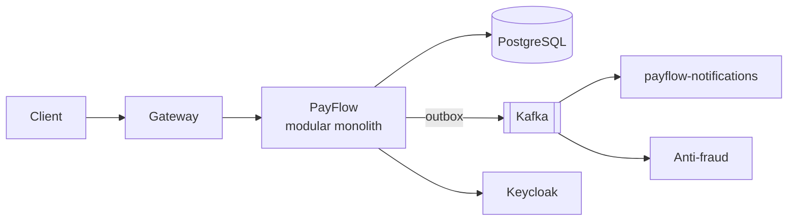

# PayFlow — a study digital wallet (Java 25 · Spring Boot 4.1 · PostgreSQL 18)

[](https://github.com/<your-user>/payflow/actions/workflows/ci.yml) · [Versão em português](README.md)

## What it is
A **study project**: a digital wallet built from scratch by one person during a junior → senior Java course. Sign-up and login, accounts, deposits, **transfers between accounts in one ACID transaction**, paginated statement, notifications and anti-fraud **asynchronous through an Outbox**, observability, container deployment and infrastructure as code. Payments were chosen because they force you to deal with money, concurrency, idempotency, security and consistency.

## What this project shows
| Skill | Where | Evidence |
|---|---|---|
| Money and transactions | `TransferService` (`lockAllOrdered`) | crossed transfers without deadlock, tested against a real PostgreSQL (Testcontainers) |
| Reliable messaging | `OutboxRelay`, `IdempotentHandler` | event written in the same transaction; idempotent consumer |
| Architecture | `ModularityTests`, `ArchitectureRulesTest` | modular monolith with dependency rules checked in CI |
| Security | `AuthorizationPolicyTest` | authorization policy with cases that **fail** without the rule |
| Operations | `slo-rules.yml`, `docs/runbooks/` | SLOs with burn-rate alerts tested with `promtool` |
| Cost | `docs/finops/` | reproducible estimate with dated prices |
| Decisions | [ADRs](docs/adrs/README.md), [design doc](docs/design/transferencias-recorrentes.md) | one decision per ADR; RFC with a deadline and a decider |

## Architecture


## How to run
```bash
docker compose up -d
./mvnw spring-boot:run
curl -s localhost:8080/actuator/health
```

## How to test
```bash
./mvnw verify    # unit + integration with Testcontainers (needs Docker)
```

## Decisions
Decisions live in [short ADRs](docs/adrs/README.md) (written in Portuguese); big ones go through an RFC and a design doc. Contribution rules in [CONTRIBUTING.md](CONTRIBUTING.md).

## Limitations
- Study project: **not in production**, no real users.
- Performance and cost numbers come from **labs and models** with stated assumptions, not from real traffic.
- AWS and Kubernetes: Terraform and manifests validated locally; **nothing applied** to a real account.

## License
MIT: see [LICENSE](LICENSE).
