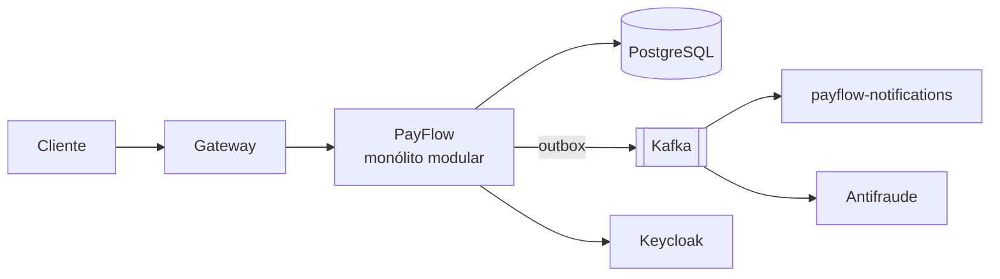

# PayFlow — carteira digital de estudo (Java 25 · Spring Boot 4.1 · PostgreSQL 18)

[](https://github.com/<seu-usuario>/payflow/actions/workflows/ci.yml) · [English version](README.en.md)

## O que é
Carteira digital **de estudo**, construída do zero por uma pessoa ao longo de um treinamento Java júnior → sênior: cadastro e login, contas, depósitos, **transferências entre contas numa transação ACID**, extrato paginado, notificações e antifraude **assíncronos com Outbox**, observabilidade, deploy em contêiner e infraestrutura como código. O domínio de pagamentos foi escolhido porque obriga a lidar com dinheiro, concorrência, idempotência, segurança e consistência.

## O que este projeto demonstra
| Competência | Onde ver | Evidência |
|---|---|---|
| Dinheiro e transações | `TransferService` (`lockAllOrdered`) | transferências cruzadas sem *deadlock*, testadas contra PostgreSQL real (Testcontainers) |
| Mensageria confiável | `OutboxRelay`, `IdempotentHandler` | evento gravado na mesma transação; consumidor idempotente |
| Arquitetura | `ModularityTests`, `ArchitectureRulesTest` | monólito modular com regras de dependência verificadas no CI |
| Segurança | `AuthorizationPolicyTest` | política de autorização com casos que **falham** sem a regra |
| Operação | `slo-rules.yml`, `docs/runbooks/` | SLOs com alertas por taxa de queima testados no `promtool` |
| Custo | `docs/finops/` | estimativa reproduzível com preços datados |
| Decisões | [ADRs](docs/adrs/README.md), [design doc](docs/design/transferencias-recorrentes.md) | uma decisão por ADR; RFC com prazo e decisor |

## Arquitetura


## Como rodar
```bash
docker compose up -d
./mvnw spring-boot:run
curl -s localhost:8080/actuator/health
```

## Como testar
```bash
./mvnw verify    # unidade + integração com Testcontainers (precisa de Docker)
```

## Decisões
As decisões ficam em [ADRs curtas](docs/adrs/README.md); as grandes passam por RFC e design doc. Regras de contribuição em [CONTRIBUTING.md](CONTRIBUTING.md).

## Limitações
- Projeto de estudo: **não está em produção** e não tem usuários reais.
- Números de desempenho e de custo vêm de **laboratórios e modelos** com premissas declaradas, não de tráfego real.
- AWS e Kubernetes: Terraform e manifestos validados localmente; **nada aplicado** numa conta real.

## Licença
MIT: veja [LICENSE](LICENSE).
